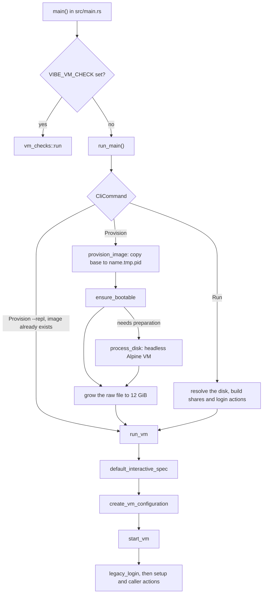

# How a VM boots

Vibe has two commands that boot a virtual machine. `vibe` (and `vibe path/to/disk.raw`) attaches the terminal to an existing raw disk and leaves that file unchanged. `vibe provision` copies a base image to a private work file, may prepare that copy once, then boots the copy, runs scripts, and publishes it as a named template.

Both commands reach the same interactive boot: `run_vm` in `src/vm_run.rs`. Disk inspection and the Alpine maintenance VM run only from `provision_image` (`src/provision.rs`), on the work copy, before that boot.



Virtualization.framework completion handlers run on the process main thread. `main` therefore calls `vm_checks::run` before CLI parsing when `VIBE_VM_CHECK` is set. The normal CLI never sets that variable. `ensure_signed` (`src/main.rs`) checks for the `com.apple.security.virtualization` entitlement and, when it is missing, `codesign`s the binary with `src/entitlements.plist` and re-executes it.

## Disk files

The cache directory, called the default directory below, is `$XDG_CACHE_HOME/vibe`, or `~/.cache/vibe` when `XDG_CACHE_HOME` is unset.

`run_main` builds `ImageDirs::from_env` (`src/image_dirs.rs`) right after `--version` and before `--help`, so a bad configuration fails every command except `--version`. `VIBE_EXTRA_IMAGE_DIR` (`:` separated absolute paths) adds image directories and `VIBE_PREFERRED_IMAGE_DIR` names the preferred one, which must be the default directory or an extra entry and must exist. Lookup order is the preferred directory, the default directory, then the other extra directories in written order. Entries are compared after removing trailing `/` and, when they exist, after `canonicalize`; duplicates are dropped. Extra directories that do not exist are marked `(missing, skipped)`. Run and provision print `ImageDirs::describe` once after `ensure_signed`; `--help` prints it after `Cache directory:`.

Image names (`--image`, `--base NAME`, `default`) go through `find_named_image`, and the Debian base through `locate_debian_base`. Positional `path/to/disk.raw`, `--base` with a `/`, and `.vibe/instance.raw` are not looked up. The Location column below says where each file lives.

| File | Location | Who creates it | Role |
| --- | --- | --- | --- |
| `debian-13-nocloud-arm64-20261001-2618.tar.xz` | Preferred | `ensure_base_image` | Downloaded Debian base archive. Only needed when no image directory has the `.raw`; an archive in another directory is not reused. |
| `debian-13-nocloud-arm64-20261001-2618.raw` | First match, else preferred | `extract_disk_raw` | Unpacked base. The member inside the archive is `disk.raw`. This file is never modified. |
| `alpine-3.24.2-aarch64-tiny-r1.raw.tar.gz` and `.raw` | First match, else preferred | `ensure_alpine_image` | Pinned Alpine maintenance image. Downloaded only when a work copy needs preparation. A `.raw` outside the preferred directory is only reused read-only when its UUID checks out. |
| `alpine.lock` | Preferred | `FileLock::acquire` | Serializes Alpine download and extract. |
| `<name>.raw` | First match, else preferred | `provision_image` | Published template. `default.raw` is the template used when `--image` is omitted. `--replace` replaces it where it was found. |
| `<name>.tmp.<pid>` | Next to `<name>.raw` | `provision_image` | Private work copy. Renamed onto `<name>.raw` only after a successful provision. |
| `<name>.tmp.<pid>.lock` | Next to `<name>.raw` | `FileLock::try_acquire_existing` | Sibling lock for the maintenance VM. The disk image itself is not flocked, because Virtualization.framework then refuses the attachment. |
| `maint/<pid>-<nonce>/` | Next to the Alpine `.raw`, else preferred | `process_disk` | One maintenance run: Alpine clone, seed ISO, EFI variable store, console log. |
| `logs/maint-<unix>-<pid>.log` | Default | `publish_log` | Published maintenance console with a header of full paths. The newest five logs are kept. |
| `mise-cache/`, `apt/`, `cargo/`, `yarn/`, `m2/`, `go/`, `guest_node_modules/`; agent configuration (`codex/`, `copilot/`, ... only with `--mount-agents-conf`) | Default | `create_cache_share` | VirtioFS share sources, created only when they are mounted. |
| `vibe-usernet` | Default | `ensure_usernet_helper_extracted` | Bundled user-mode network helper, written out when the cached bytes differ. |
| `.vibe/instance.raw` | Project | `ensure_instance_disk` | Per-project disk, copied once from a template. This is the file a normal `vibe` boots. |
| `.vibe/vibe-usernet.log` | Project | `NetworkMode::prepare` | Helper log for a project instance. An external `path/to/disk.raw` does not get one. |
| `$TMPDIR/efi_variable_store_<pid>.efivars` | `$TMPDIR` | `default_efi_vars_path` | EFI variable store for an interactive VM. Recreated with `AllowOverwrite` on each start. |

### Debian base

`DEBIAN_COMPRESSED_DISK_URL` in `src/images.rs` is the Debian 13 "trixie" nocloud arm64 image `20261001-2618`. `ensure_base_image` returns immediately when the `.raw` already exists. Otherwise it downloads with `curl` when the archive is missing or smaller than `DEBIAN_COMPRESSED_SIZE_BYTES`, checks SHA-512 with `verify_sha512` (`/usr/bin/shasum`), and extracts with `extract_disk_raw` (bytes land in a sibling temp file, then `cache::replace`). Failures use the `[download]` prefix.

`run_main` calls `ensure_base_image` when provisioning with no `--base`, and `ensure_default_image` calls it again before the first `default.raw` is built.

### Alpine maintenance image

`ALPINE_IMAGE_NAME` in `src/alpine.rs` is `alpine-3.24.2-aarch64-tiny-r1`. The archive URL and SHA-512 are `ALPINE_ARCHIVE_URL` and `ALPINE_ARCHIVE_SHA512`. The archive is about 66 MB. The extracted raw is a sparse file of about 1 GiB.

`ensure_alpine_image` holds `alpine.lock`, then `ensure_locked`:

1. A corrupt archive is deleted and fetched again with `images::fetch_verified` (download to `.part`, check SHA-512, rename).
2. `extract_disk_raw` publishes `{name}.raw`.
3. `alpine_root_uuid_matches` requires partition 2 (`ALPINE_ROOT_PART`) to be ext4 with UUID `ALPINE_ROOT_FS_UUID`. Alpine finds its own root by the label `/`.

A valid raw plus a valid archive does not touch the network. The cached raw is a read-only input. `run_maintenance` clones it with `cache::clone_file` (APFS clone, copy as fallback) into the maintenance directory and boots the clone. The Alpine image is never the disk of a user VM. A work copy that `classify` calls legacy compatible never downloads it.

### Named templates and the project instance

`image_path` maps a name to `{cache}/{name}.raw`. Names are ASCII alphanumeric plus `-` and `_` (`assert_valid_image_name`).

`provision_image` builds a template like this:

1. `fs::copy` the base onto `{name}.tmp.{pid}` and add user-write permission. The base file stays as it was.
2. `ensure_bootable` on that copy, at the copy's original size. Growing the file first would make the maintenance manifest disagree with the partition table.
3. If the copy is shorter than `DEFAULT_DISK_SIZE` (`DEFAULT_DISK_GB` is 12, so 12 GiB), `set_len` extends it. The extra bytes are sparse.
4. Boot the copy. When `--root-password` or `VIBE_ROOT_PASSWORD` is set, that password is applied with `chpasswd` after login and before `.profile` and the scripts. Then the scripts run. `provisioning/base.sh` is always the first script. It installs the base packages and then runs `growpart /dev/vda 1` and `resize2fs /dev/vda1`.
5. Clear `/etc/machine-id`, confirm the clear with `probe_disk`, and `fs::rename` the work copy onto `<name>.raw`.

`ensure_default_image` does this once for `default.raw`, with every built-in script. An existing `default.raw` is returned immediately and is not probed again. The first plain `vibe` in a project with no instance disk calls `ensure_default_image` when `--image` is `default` (or omitted).

`ensure_instance_disk` copies the chosen template to `.vibe/instance.raw` (`INSTANCE_DIR_NAME`, `INSTANCE_DISK_IMAGE_NAME`) when that file is absent. Later runs boot the instance as it is. `vibe --image NAME` is ignored once `.vibe/instance.raw` exists (`run_main` prints that when `NAME` is not `default`).

A positional `path/to/disk.raw` is booted as given (`DiskSource::External`). It does not create `.vibe/instance.raw` and does not read the cache templates.

Every published image has an empty `/etc/machine-id`. Each instance therefore generates its own machine id on first boot and keeps it across reboots. The root password field stays empty unless the provision that published the image was given `--root-password` or `VIBE_ROOT_PASSWORD`. In that case the same password is set before the scripts run.

## From the CLI to a running guest

### `run_main`

`parse_cli` (`lexopt`) fills `CliArgs`. `run_main` creates the cache directory, calls `ensure_signed`, and prepares a closure over `NetworkMode::prepare`. Each command builds its own cache shares: `cache_share_specs(sys_cache, mise, agents_conf)` picks from `MISE_CACHE_SHARE`, `SYS_CACHE_SHARES`, and `AGENT_CONF_SHARES` (in that order), and `create_cache_shares` creates only those host directories.

Before `run_vm`, run and provision print `describe_vm_files`: the directory shares (`host -> guest (mode)`) and the files Vibe writes into the VM, or `(none)`.

In `nat` mode `guest_proxy` is `None`: the `vibe-usernet` helper applies `--proxy` itself, so the guest does not also receive proxy variables. In `vznat` mode the `--proxy` URL is passed into provisioning scripts and into login exports.

### Run

`CliCommand::Run` in `run_main`:

1. Resolve the disk, as described above. `DiskSource` is `External` or `Instance`. The network log directory is `.vibe/` only for the instance disk.
   For the default image, when `default.raw` does not exist yet, `check_implicit_provision` first rejects `--no-mount-sys-cache` / `--no-mount-mise` (the error names the options, the `default.raw` path, and `vibe provision`), before `ensure_default_image` looks up or downloads anything. `ensure_default_image` receives the cache directory and creates the shares only when it provisions, always with `cache_share_specs(true, true, false)`.
2. Unless `--no-mount-cwd`: share the project directory at `<project>` below the HOME of the `--vm-user` (`/root/<project>` for root; `is_project_dir`) and `cd` into it. `--mount` shares are also `is_project_dir`. Guest paths are `GuestPath` values (`src/vm_user.rs`): absolute, or relative to that HOME. For root a relative path renders as `/root/<path>`; for another user as `"${VIBE_VM_HOME}"/<path>`. `project_masks_and_shares` handles every project directory: mask `.vibe` with tmpfs, share `node_modules` from the cache when the host directory exists, and share or mask `.git` according to `--git` (default read-only; a `.git` file, as in a submodule, is skipped). `.env` and other files are not masked. Then append `cache_share_specs(mount_sys_cache, mount_mise, mount_agents_conf)`: apt stays at `/var/cache/apt`, the other caches are relative to HOME (`.cargo`, `.local/share/mise`, ...); the agent config directories (`codex`, `copilot`, `claude`, `gemini`, `pi`, `grok`, `opencode`) only with `--mount-agents-conf`. With `--mount-tmux-conf`, `tmux_conf_mounts` shares `~/.tmux` read-only at `.tmux` when it is a directory and queues a `Send` that writes host `~/.tmux.conf` to `.tmux.conf` in the user's HOME (`write_user_file_into_vm`; for a non-root user the file is written by the user through `runuser`); when neither exists it prints a warning.
3. `run_session_plan` builds a `SessionPlan` (`src/session_plan.rs`). Its `root_prepare` checks a non-root `--vm-user` (`check_vm_user_actions`, see below). Its `root_actions` are the tmux `Send`, `--write-bashrc` (for root `write_bashrc_actions`: write `src/bashrc.sh` to `/root/.profile`, then ` . /root/.profile`; for another user `write_user_bashrc_action` writes the user's `~/.profile`, which `su --login` reads; without the option nothing writes or sources `.profile`), and the `--ssh-key` commands (`authorized_keys` of the user, written through `runuser` for a non-root user; `systemctl start ssh`; `ip -4 -br addr`). For a non-root user `switch_user` is set, so the session switches to the user between `root_actions` and `user_actions` (see below). Its `user_actions` are `cd` into the project, host `--env` exports (`env_login_actions`), `HISTFILE`, the share table (`motd_login_action`, with paths such as `~dev/proj` for a non-root user), proxy exports when `guest_proxy` is set, and finally the user's `--script`, `--send`, and `--expect` actions. `numbered` is the index range of the user's actions so later errors number only those actions. For a non-root user `restrict_apt_cache` and `warn_passwordless_root` are set.
4. Print `describe_vm_files("Run", ...)` (`/root/.bash_logout`, plus `.profile` and `.tmux.conf` in the user's HOME when written) and, for `--no-mount-mise` / `--no-mount-sys-cache`, a note that the tools in the shared directories are not available. Call `run_vm`.

For root, every action runs in the root shell and there is no switch. For another user, the `user_actions` (including `--send`, `--expect`, and `--script`) run in that user's shell.

### Provision

`CliCommand::Provision`:

- The cache shares are `cache_share_specs(mount_sys_cache, mount_mise, false)`. `--no-mount-sys-cache` / `--no-mount-mise` print a note that the tools are installed into the image itself and that the image has to be run with the same option to see them.
- A non-root `--vm-user` without a root password (`--root-password` or `VIBE_ROOT_PASSWORD`) is an error before anything is copied or booted (`check_provision_root_password`): the user could otherwise become root with `su -`.
- `--repl` with an existing image and without `--replace` prints a line, the share log (`Provision`), and calls `run_vm` on that image (`DiskSource::CachedImage`) with `existing_image_repl_actions` as its only actions (root: `write_bashrc_actions`; another user: `write_user_bashrc_action` only). A non-root `--vm-user` is checked with `check_vm_user_actions` (never created), the passwordless-root warning applies, and the session switches to the user, with a notice that `exit` returns to the root shell. No scripts run, and the image is not probed.
- Otherwise resolve `--base`. A value that contains `/` is a filesystem path. A value without `/` is `image_path` in the cache. With no `--base`, `ensure_base_image` supplies the Debian raw.
- Call `provision_image`.

`provision_image` (`src/provision.rs`) refuses to overwrite an existing `<name>.raw` unless `--replace` is set. It copies the base, calls `ensure_bootable`, grows the file, then `build_provision_plan` builds a `SessionPlan`. Its `root_prepare` runs before the share mounts: `set_root_password_actions` when a password is given, then `ensure_vm_user_actions` for a non-root `--vm-user` (`src/guest/ensure_vm_user.sh`: `useradd --create-home --home-dir /home/<name> --shell /bin/bash --user-group <name>` when the account does not exist; an existing account is left unchanged), followed by the same check as a run. The shares are mounted at the user's paths, as in a run. Its `root_actions` start with `install_bindfs_action` (a `StatusCommand` labelled `install bindfs`; `apt-get install bindfs`, with the `vznat` guest proxy passed to apt), so every image can later run with a non-root `--vm-user`. Then `write_bashrc_actions`: write `src/bashrc.sh` to `/root/.profile` and source it, so PATH and mise activation apply to the scripts and the file is saved with the image (errors here are `[login] setup send`). A non-root `--vm-user` also gets the same file as its own `.profile` (`write_user_bashrc_action`). Then:

1. One `Send` exporting `VIBE_PROVISION_IMAGE`, `VIBE_PROVISION_BASE`, `VIBE_GIT_SHA`, `VIBE_BUILD_DATE`, `VIBE_PROVISION_SCRIPTS`, and `VIBE_PROVISION_VM_USER` (`provisioning/base.sh` records it as `vm_user:` in the provision history).
2. Script actions: `@base` from `build_provision_script` (the `INJECT_PROXY_CODE` region in `provisioning/base.sh` is filled when `guest_proxy` is set), then the extra scripts. This range is the plan's `numbered`, so a script failure is `[action N: script '...']`. For root, and for any script that is not built in, each script is one `Script` run by root (custom scripts see `VIBE_VM_USER` and `VIBE_VM_HOME`). For a non-root user, a built-in script is split at the line `# vibe:run-as-user` (`split_run_as_user`): the part before it is a `Script` run by root (skipped when it has no commands), and the part after it, with the shebang line, is a `UserScript` run as the user. Each part carries its own `set -euxo pipefail` and helpers. `@base` installs mise only on the first provision of an image: its root part touches `/run/vibe/base-first-run`, and its user part stops when that file is missing or `~/.local/state/vibe/base-user.done` exists. A later provision of an image without that stamp prints a warning that the user-level tools are missing.
3. For a non-root user, `check-vm-user-home`: a root `Script` that fails when the user's HOME (on its filesystem, skipping mount points) contains files owned by root, so tools meant for the user were not installed by root. Its failure is `[shutdown]`.
4. `finalize-machine-id`. Without `--repl` this is `CLEAR_MACHINE_ID_SCRIPT`, which refuses a mount overlay or a symlink and truncates `/etc/machine-id` and a regular `/var/lib/dbus/machine-id`. With `--repl` it is `REPL_FINALIZE_SCRIPT`: a transient `vibe-finalize-template` unit under `/run` clears the id at poweroff, so the open shell still has the id systemd wrote at boot.
5. `Send` / `Expect` of `VIBE_PROVISION_SUCCESS`.
6. Without `--repl`, `systemctl poweroff; sleep 100`. With `--repl`, `run_vm` prints the interactive notice and waits for the user to exit. With `--repl` and a non-root user the plan sets `switch_user`, so the shell is the user's; `exit` returns to root, and `exit` there powers off and the image is saved.

Before `run_vm` it prints `describe_vm_files(stage, ...)` (`Provision`, or `Provision (implicit, for the default image)` from `ensure_default_image`) and the notes passed in by the caller. `run_vm` is called with `disk_source: None`, so a failure of this boot does not append a "provision this disk" hint. After the VM stops, `incomplete_run_error` rejects a run whose actions did not finish or whose final state is not `Stopped`. `probe_disk` must then report `MachineIdFact::EmptyFile`, or the error is `[verify]` and the image is not published. `fs::rename` publishes the work copy.

Any error deletes `<name>.tmp.<pid>` unless `VIBE_KEEP_FAILED_WORK=1`. A failed provision never publishes a partial image. `failed_work_message` prints the kept path, or tells you to set the variable.

## Interactive boot

`run_vm` prints the disk, CPU count, and RAM, then calls `drive_interactive`. Defaults are 2 CPUs and 2048 MiB for a run (`DEFAULT_CPU_COUNT`, `DEFAULT_RAM_BYTES`). A provision uses 2 CPUs and 4096 MiB (`DEFAULT_PROVISION_RAM_BYTES`) unless `--cpus` or `--ram` is set.

### Configuration and start

1. `create_pipe` (`src/vm_io.rs`) builds three socket pairs: bytes the guest reads (host keystrokes and typed actions), bytes the guest writes (console output), and resize bytes the guest reads on the second serial port.
2. `prepare_network_backend` calls `NetworkMode::prepare` (`src/networking.rs`). `nat` extracts `vibe-usernet`, spawns it with a datagram socket pair and a liveness pipe, and returns `PreparedNetworkBackend::Usernet`. `vznat` returns `PreparedNetworkBackend::VzNat` and does not spawn the helper. When a log directory was passed, helper stderr goes to `vibe-usernet.log`.
3. `default_interactive_spec` (`src/vm_config.rs`) builds a `VmSpec`: one writable `DiskSpec` (guest `vda`), the network backend, a VirtioFS device tagged `shared` (`SHARED_DIRECTORIES_TAG`) when there are shares, serial role `Terminal` then `Resize`, the temp EFI store path, and the CPU and RAM counts. Port order is the guest order: `hvc0` is the console, `hvc1` is the resize channel.
4. `create_vm_configuration` turns that spec into a `VZVirtualMachineConfiguration`:
   - `VZGenericPlatformConfiguration` and `VZEFIBootLoader`. Boot is EFI only.
   - `load_efi_variable_store` creates the variable store.
   - Virtio network: `VZFileHandleNetworkDeviceAttachment` on the usernet socket with MAC `USERNET_MAC_ADDRESS`, or `VZNATNetworkDeviceAttachment`.
   - `VZVirtioEntropyDeviceConfiguration`.
   - One `VZVirtioBlockDeviceConfiguration` per disk (`VZDiskImageCachingMode::Cached`, `VZDiskImageSynchronizationMode::Full`).
   - `VZVirtioFileSystemDeviceConfiguration` / `VZMultipleDirectoryShare` for shares.
   - `VZVirtioConsoleDeviceSerialPortConfiguration` per serial port.
   - `validateWithError`. A missing disk fails in `initWithURL` and is reported by `disk_attachment_error`.
5. `start_vm` (`src/vm_lifecycle.rs`) creates the `VZVirtualMachine` on the main dispatch queue, calls `startWithCompletionHandler`, and pumps `NSRunLoop` until the handler fires or `START_TIMEOUT` (60 seconds) elapses.

`create_vm_configuration` and `start_vm` errors are prefixed `[boot]` in `drive_interactive`. The host then prints `VM booting...`.

### Console I/O and the login thread

`spawn_vm_io` starts the terminal threads. Guest output is copied to the host terminal and into an `OutputMonitor` (`wait_for_text`, `wait_for_any`, `wait_for_line_after` return `Found`, `Timeout`, or `Closed`). The stdin thread calls `decide_user_input`: keystrokes are discarded until `input_open` is set, and two consecutive Ctrl-C bytes while the gate is closed set `stop_requested`. The resize thread writes `rows cols` to `hvc1` when the host terminal changes size.

`drive_interactive` builds the full action list with `expand_session` (`src/session_plan.rs`):

1. `legacy_login_prefix(LOGIN_EXPECT_TIMEOUT, root_password)` with `LOGIN_EXPECT_TIMEOUT` = 120 seconds. `root_password` comes from `--root-password`, or from `VIBE_ROOT_PASSWORD` when that flag is omitted.
2. The plan's `root_prepare`: the root password, then the `--vm-user` step. For a non-root user, that step exports `VIBE_VM_USER`, `VIBE_VM_UID`, `VIBE_VM_GID`, and `VIBE_VM_HOME`, which later paths and mounts use.
3. When shares exist: `mkdir -p /mnt/root/virtiofs-shared && chmod -R 700 /mnt/root && mount -t virtiofs shared /mnt/root/virtiofs-shared`, so the staging directory is only reachable by root. Then for each share, create the target and `mount --bind` the staging subdirectory onto it. Below the HOME of a non-root user, each missing directory is created with `install -d -o "$VIBE_VM_UID" -g "$VIBE_VM_GID"`. With `restrict_apt_cache` the apt cache is a `StatusCommand` labelled `mount apt cache`: `bindfs -u _apt -g 0 -p 0755,af-x`, so the files appear owned by `_apt` and other users can read but not write them, while root's apt still downloads into the host cache. When `bindfs` or the `_apt` account is missing (for example an image provisioned before Vibe installed `bindfs`), it falls back to a writable bind mount and the host prints a warning that suggests a new provision or `--no-mount-sys-cache`.
4. The masks: `mount -t tmpfs -o mode=0555,uid=0,gid=0 tmpfs <path>`, an empty directory owned by root that other users cannot write.
5. The caller actions: the plan's `root_actions`, then (when `switch_user` is set) the switch, then `user_actions`. The switch first types ` sysctl -q -w dev.tty.legacy_tiocsti=0 2>/dev/null || true`, so a program of the user cannot push input into the root shell's terminal, then `LoginAction::SwitchUser` types `SWITCH_USER_COMMAND`: ` su --login --pty "$VIBE_VM_USER"; echo; echo 'Vibe: back in the root shell. ...'`. The root shell reads that whole line, so the notice only appears after the user's shell exits. A probe like the root readiness probe (a split marker, then `id -un` and `id -u`) is retried every 10 seconds for up to 120 seconds; it must report the user's name and a non-zero uid, otherwise the error is `LoginFailure::SwitchFailed` (`[login] Switching to vm-user ...`). The switch is labelled `[login] setup`.
6. Two trailing `Send`s that activate `mise` and `fzf` when those commands exist.

A `StatusCommand` runs its command in a group with stdin from `/dev/null` (so a tool such as apt-get cannot consume the line typed after it), then prints `VIBE_STEP_STATUS_<id>` followed by `<exit status> <notice>`. A non-zero status fails the action. A non-empty `__vibe_notice` becomes `VmOutput::Notice`, which `drive_interactive` prints as a warning (for example, a `--vm-user` in the `sudo` or `adm` group).

`action_prefix` labels each index. Actions inside the user range are `[action N: ...]`, counting from 1. Caller actions after that range (provision's finalize and poweroff) are `[shutdown] ...`. Actions before the caller range, and the trailing `mise` and `fzf` sends that sit after it, are `[login] setup ...`. `LoginAction::label` for a `Send` is the word `send` and does not include the typed text.

`spawn_login_actions_thread` (`src/session.rs`) runs that list on a background thread and reports `VmOutput` on a channel. The main thread pumps the run loop every 0.2 seconds, applies those messages, and calls `request_stop` when an action fails or when `stop_requested` is set (the error is `[shutdown] Stopped because Ctrl-C was pressed twice before setup finished.`). `request_stop` uses `canRequestStop` and falls back to `stopWithCompletionHandler`. `VIBE_FORCE_STOP_AFTER_LOGIN=1` is a test hook: after `LoginReady`, `force_stop` leaves the guest filesystem dirty.

When the VM leaves `Running`, or a stop was requested, `output_monitor.close()` unblocks the actions thread. `drive_interactive` joins it, shuts down the I/O threads, and returns. If `LoginReady` never arrived, the error is `LoginFailure::VmStopped` (`[boot] The VM stopped before the root login completed`). `RunOutcome` records whether every action finished, whether the final state was `Stopped`, and the prefix of the caller action that was still running.

### Legacy root login

`legacy_login` implements `LoginAction::LegacyLogin`. It is the only login path. There is no cloud-init channel.

1. `wait_for_text("login: ", timeout)`. Zero bytes on `hvc0` is `LoginFailure::NoSerialOutput`. Any other timeout is `NoLoginPrompt`. Both display as `[boot]`.
2. Type `root`.
3. `wait_for_any` of `Password:`, `Debian GNU/Linux`, and `login: `. A timeout is `NoBanner`.
   - `Password:` with no password supplied is `LoginFailure::PasswordRequired`: `[login] The image asks for a root password (disk: ...). Pass --root-password to log in.`
   - `Password:` with a password supplied types that password. The password is not logged. The next wait is `Login incorrect`, `Debian GNU/Linux`, `Last login`, and `login: `. `Login incorrect` or another `login: ` is `AuthFailed`: `[login] root authentication failed with the given --root-password (disk: ...)`. A timeout is `AuthTimeout`: `[login] Sent the root password but saw neither a successful login nor 'Login incorrect' within {timeout:?} (disk: ...)`. Any other match continues to the readiness probe.
   - Any other match leaves the password untyped and continues to the probe.
4. Type a readiness probe. `readiness_probe_command_and_marker` builds a `printf` whose marker `VIBE_READY_<nonce>` is split across two arguments, so the echoed command line does not contain the marker. The next line must be `id -u` equal to `0`. Anything else is `ProbeTimeout` or `ProbeNotRoot` (`[login]`).

`LoginReady` is sent when the probe returns uid 0. It records `password_prompted` when the guest asked for a password and accepted it. When it is false and the plan sets `warn_passwordless_root` (a run or an existing image's `--repl` with a non-root `--vm-user`), `drive_interactive` prints `Warning: root has no password in this image; user '<name>' can become root with 'su -'. ...` and continues. `input_open` stays false until `ActionsCompleted`, which is after the setup sends, the share mounts, and the caller's actions. Until then the keyboard is discarded.

The setup sends inside `legacy_login_prefix` are: `HISTCONTROL=ignorespace` and `unset HISTFILE` (so the automatic commands stay out of history), `stty -F /dev/hvc0 sane`, a background loop that reads `rows cols` from `/dev/hvc1` and applies them to `hvc0`, then `write_file_into_vm` of `src/bash_logout.sh` to `/root/.bash_logout`. It never writes or sources `/root/.profile`; provision and `--write-bashrc` add `write_bashrc_actions` to the caller's actions instead. The logout script runs `systemctl poweroff` on a normal exit. It skips poweroff when the shell is SSH, is inside tmux, tmux has a session, or any tmux server process is running (`pgrep '^tmux: server'`, which matches the process name that tmux sets for its server; root's `tmux list-sessions` does not see another user's server).

`Script` actions (`script_command`) base64-decode into `/tmp/vibe-scripts-<uid>/<id>.sh`, run the file with stdin from `/dev/null`, and wait for `VIBE_SCRIPT_STATUS_<id>` plus the exit code. The directory is created with mode 0700; an existing one is reused only when it is a real directory owned by the current user, otherwise the action fails. Dropping the page cache before the script only happens for uid 0. A non-zero status is `LoginActionFailed`. The script timeout is 24 hours.

`UserScript` actions use the same wrapper with `as_vm_user` set. Root creates `/tmp/vibe-scripts-$VIBE_VM_UID` with mode 0700 and gives it to the user (an existing one is reused only when it is a real directory owned by that UID). The user writes the file through `runuser`, so a symlink there cannot make root write elsewhere. The script then runs from the user's HOME as `runuser -u "$VIBE_VM_USER" -- env ... HOME=... USER=... LOGNAME=... SHELL=/bin/bash bash --login -c 'exec "$0"' <file>`: `runuser` without `--login` keeps the variables root exported (the `vznat` proxy, `VIBE_PROVISION_*`), `env -u` drops root's mise session variables, and the login shell reads the user's `.profile` before it `exec`s the script. The `exec` matters: when a login shell exits it runs `~/.bash_logout`, and Debian's skeleton version ends with `clear_console`, whose status would replace the script's.

### vm-user check

`check_vm_user_actions` (`src/vm_user.rs`) runs `src/guest/check_vm_user.sh` as a `StatusCommand` labelled `check vm-user`. Exit codes 10 to 15 mean: the account does not exist, has UID 0, does not use bash, has no usable HOME directory, has a HOME not owned by it, or has `/root` as HOME. `drive_interactive` turns them into `LoginFailure::VmUser`: `[login] vm-user '<name>' ...`. A missing account suggests `vibe provision --base <disk> --image <new-name> --vm-user <name>`; the other problems say that Vibe does not change existing accounts. On success the script prints `groups=<list>` when the account is in `root`, `sudo`, `adm`, `wheel`, or `admin`, which becomes a warning. For root the check is skipped.

### Boot failure hint

`suggests_provision` is true for silence, a missing `login:` prompt, and a VM that stopped before login. `PasswordRequired`, `AuthFailed`, and `AuthTimeout` do not suggest `vibe provision`. When `disk_source` is `Some` and `suggests_provision` is true, `needs_provision_hint` appends a `vibe provision` command. The wording stays tentative: the run path did not inspect the disk.

- `DiskSource::External`: `vibe provision --base <absolute disk> --image <name>`, then `vibe --image <name>` in a project.
- `DiskSource::Instance`: the same provision command, then move `.vibe/instance.raw` aside and run `vibe --image <name>` so a new instance is copied from the prepared image.
- `DiskSource::CachedImage`: `vibe provision --base <name> --image <new-name>`, or `vibe provision --image <name> --replace` to rebuild that name from the Debian base.

An unprocessed current Debian disk produces no console output (it sits in the firstboot wizard) and hits `NoSerialOutput` after 120 seconds. The `[boot]` error includes the command above.

## Disk preparation during provisioning

`ensure_bootable` (`src/disk_prepare.rs`) is the only caller of the Alpine VM on the provision path.

### Host classification

`probe_disk` (`src/image_probe.rs`) always returns a class. It reads the file on the host with `pread`. `gpt::read_gpt` and `gpt::select_layout` require one EFI System Partition and one root: the ARM64 root type `LINUX_ROOT_ARM64_GUID` when that type is present, otherwise a single `LINUX_FILESYSTEM_GUID` partition. `Ext4Ro` reads `/etc/os-release` (one lexical symlink step; Debian's `/etc/os-release` points at `../usr/lib/os-release`), `/etc/debian_version`, `/etc/machine-id`, `/etc/shadow`, and `/var/lib/dbus/machine-id`. Shadow bytes are parsed for the root password field and then zeroed. They are not stored on `ProbeFacts`. `VIBE_TRACE_PROBE=1` logs each `probe_disk` path. The run path never sets that and never calls `probe_disk`.

`classify` then `prepare_decision`:

| `ImageClass` | Decision | What happens |
| --- | --- | --- |
| `LegacyCompatible` | `AlreadyCompatible` | Print `Disk is already legacy compatible; skipping Alpine preparation.` Debian, machine-id missing, an empty file, or a valid 32-hex id, exactly one `root:` shadow line, and an empty password field. |
| `Unsupported` | `WarnUnsupported` | `unsupported_warning` prints `[probe] Warning: ...` and the copy is booted on the legacy login path anyway. This is `no GPT root`, or an ext4 root whose `os-release` is not Debian (`ID=debian`, or `ID_LIKE` containing `debian`). Login will usually fail on these disks. |
| `NeedsPreparation` | `Process` | machine-id is `uninitialized\n` or some other content, or the root password field is not empty. `preparation_notice` names those reasons and says the step takes about 20 seconds. |
| `Unknown` | `Process` | The bounded reader could not decide (unreadable filesystem, `needs recovery`, machine-id symlink, unexpected root line count, and similar). Alpine checks the image itself. |

`EMPTY_ROOT_NOTICE` is printed before a preparation: after it, root has an empty password in this image and in VMs created from it.

### Maintenance VM

`process_disk` (`src/maintenance.rs`):

1. `prepare_target` requires a regular, writable file. It opens the disk read-write only to prove it can write, then takes a non-blocking flock on the sibling `{disk}.lock`. It reads the GPT, selects the layout, and `scan_labels`. `label_block_reason` rejects an ext4 UUID equal to `ALPINE_ROOT_FS_UUID`, and a filesystem label `/` or `cidata` (any case). It records `ProbeFacts` for the later re-check.
2. `create_work_dir`: `cache::private_dir` creates `maint/<pid>-<nonce>` mode `0700` in the directory of the Alpine `.raw`, so the clone stays on one file system. When that fails (for example a read-only volume), it prints a line and uses `maint/` in the preferred directory instead. `cache::sweep_stale` then removes directories under the `maint/` root in use whose `<pid>-<nonce>` pid is dead.
3. `run_maintenance`:
   - `control::new_nonce` (32 lowercase hex digits).
   - Clone the Alpine raw to `alpine.raw` in that directory.
   - Build a `seed::Manifest`: format 1, the nonce, the Alpine root UUID, the work-copy byte size, root partition index, PARTUUID, type GUID, ESP index, `policy=minimal`. `Manifest::serialize` rejects anything else.
   - `seed::build_seed` writes `meta-data`, `user-data` (the embedded `src/guest/maint.sh`), and `manifest`, then `hdiutil makehybrid` with volume name `cidata`. The ISO must be non-empty and under 8 MiB.
   - `VmSpec` disks, in guest order: `vda` the Alpine clone (writable), `vdb` the Debian work copy (writable), `vdc` `seed.iso` (read-only). `network` is `None`. There are no share devices and no keyboard serial port. `hvc0` is `SerialRole::Log`, `hvc1` is `SerialRole::Control` (`output_serial` keeps the host read end). EFI variables live at `efivars` inside the work directory. CPU count is 2 and RAM is 1 GiB (`MAINT_CPU`, `MAINT_RAM_BYTES`).
   - `run_headless` starts that spec. The log worker copies `hvc0` to `hvc0.log`. The control worker feeds `hvc1` to `FrameReader::new(nonce)`. Each accepted frame goes to `observe_frame`.
4. On success, `image_probe::verify_processed` re-reads the work copy. It requires an unchanged GPT layout, `/etc/machine-id` as an empty regular file, exactly one root shadow line with an empty password field, a dbus machine-id that is missing, empty, or a symlink to `/etc/machine-id`, and `classify` == `LegacyCompatible`. A failure is `[verify] host-verify`.
5. `publish_log` writes the console log to `logs/maint-<unix>-<pid>.log` in the default directory, after a `log_header` that lists the full paths of the disk, the Alpine source `.raw`, the Alpine clone, the seed ISO, and the work directory, and `retain_newest_logs` keeps `LOGS_TO_KEEP` (5). The work directory is removed unless `VIBE_KEEP_FAILED_WORK=1`, in which case its path is printed. The next `process_disk` still deletes a kept directory once that pid is gone. `ensure_bootable` unlinks the sibling `.lock` file afterward, unless the error was that another Vibe process holds it.

`PrepareError` prints `[prepare] <stage> (last PREP-STEP: ...)` plus the log path. The host re-check uses `[verify]`.

### What the guest script does

`src/guest/maint.sh` is the NoCloud `user-data`. tiny-cloud runs it. It writes the console to `hvc0` and control frames to `hvc1` as `VIBE1 <nonce> <kind> ...` (`control::Frame`, at most `MAX_FRAME_LEN` bytes). The host sends no frames. The nonce ties a line to this run. It is not an authenticator.

`mount_seed` mounts `LABEL=cidata` and requires the device to be `/dev/vdc`. A seed that cannot be mounted emits no frame. `parse_manifest` then emits `PREP-READY`.

`MAINT_STEPS` and the script run in this order. `observe_frame` rejects any other order. A guest `PREP-RESULT fail` uses the step's code from `step_code` and powers the VM off by itself. Only a protocol or step-order error makes `decision_for` return `FrameDecision::Fail`, which asks the guest to stop.

| Step | Code | Check |
| --- | --- | --- |
| `seed` | 2 | Manifest format 1, policy `minimal`, token fields. |
| `self` | 3 | Alpine's own root is `/dev/vda2` and `findfs UUID=<ALPINE_ROOT_FS_UUID>` agrees. |
| `target` | 4 | `/sys/class/block/vdb/size` matches `disk_bytes`. `sgdisk -i` on `/dev/vdb` matches the root type GUID and PARTUUID. |
| `fsck` | 5 | `e2fsck -p` on the root partition returns 0 or 1. |
| `inspect` | 6 | Mount the root read-only. `ID=debian` in `os-release`. `/etc/machine-id` is a regular file. `/etc/shadow` is a regular file with exactly one well-formed `root` line. dbus machine-id is absent, a regular file, or a symlink to `/etc/machine-id`. No `PermitEmptyPasswords yes` in `sshd_config` or `sshd_config.d/*.conf`. `/etc/passwd` has exactly one `root` line whose password field is `x`. Then remount read-write. |
| `apply` | 7 | Truncate `/etc/machine-id` and a regular dbus machine-id. `apply_shadow` rewrites the root password field to empty and keeps the file's mode and owner. Shadow contents are not printed, and the script does not enable xtrace. |
| `verify` | 8 | machine-id is an empty regular file, the shadow bytes match the cleared rendering, and the shadow mode and owner are unchanged. |
| `unmount` | 9 | `sync`, unmount, confirm nothing under `/dev/vdb` stays mounted, `e2fsck -n`. |

`PREP-RESULT ok 0 done` follows `unmount`. The exit trap powers off.

`HeadlessDeadlines::maintenance` waits 90 seconds for `PREP-READY` (`MAINT_FIRST_OUTPUT_TIMEOUT`; a measured boot is about 17 seconds, including Limine's 10 second menu), 300 seconds for `PREP-RESULT` (`MAINT_TOTAL_TIMEOUT`), then 30 seconds for a requested stop (`STOP_TIMEOUT`) before `force_stop`. Worker threads must join within 10 seconds.

The maintenance VM has no network, no shared folders, and no keyboard.

### Images the preparation refuses

These are rejected while processing, with a `[prepare]` error and no published image:

- `/etc/shadow` or `/etc/passwd` has an unexpected root entry (guest `inspect`).
- `/etc/machine-id` is a symlink or not a regular file.
- SSH configuration explicitly sets `PermitEmptyPasswords yes`.
- The GPT has no single root and no single ESP, a partition is out of bounds, or a label or ext4 UUID would make Alpine mount the wrong disk (`prepare_target`).

The host probe and the guest check are not the same test. `classify` treats `ID_LIKE` containing `debian` as Debian and does not read `sshd_config`. The guest requires `ID=debian` and does read `sshd_config`. An image that is already `LegacyCompatible` skips the guest, so the SSH line is enforced only when Alpine actually runs.

A non-Debian GPT disk is `Unsupported`: `[probe]` warning, no Alpine, then the legacy login path.

## New Debian images

Debian nocloud images published since late 2026, including the pinned `debian-13-nocloud-arm64-20261001-2618`, no longer leave the root password field empty, and the console stops in an interactive firstboot wizard. Older nocloud images booted straight to a `login:` prompt and accepted `root` with an empty password field. Vibe still types `root`. It types a password only after the guest prints `Password:` and a password was supplied.

Vibe returns a new image to that older state only while provisioning:

- The base, or the `--base` file, is copied. The original is not modified.
- The host probe skips Alpine for an older image and for an image Vibe already published.
- A new image is processed once, before `base.sh` and before the file is grown.
- Running `vibe path/to/disk.raw`, `.vibe/instance.raw`, or `vibe --image NAME` never checks or changes that disk.

To convert an unprocessed disk, provision a copy and boot the result:

```bash
# An external disk image. A --base value without "/" is a template name in the cache.
vibe provision --base /abs/path/disk.raw --image my-image
vibe --image my-image

# An old project instance created from an unprocessed image
vibe provision --base /abs/path/project/.vibe/instance.raw --image my-image
mv .vibe/instance.raw .vibe/instance.raw.old
vibe --image my-image
```

### Security

Alpine preparation leaves the root password field empty. A provision that runs scripts and was given `--root-password` or `VIBE_ROOT_PASSWORD` then sets that same password with `chpasswd` after login and before `.profile` and the scripts. The password is not written into a guest command. A run, and `provision --repl` of an existing image, use the value only to authenticate and do not change the disk. When the field is left empty, anyone who can open the console, including another tool that boots the disk, can log in as root, and a non-root user inside the guest can `su -` without a password. Vibe itself only logs in as root and does not create other users.

Debian's SSH server refuses empty passwords by default (`PermitEmptyPasswords no`). Preparation fails if a config file sets `PermitEmptyPasswords yes`. `provisioning/base.sh` also writes `PasswordAuthentication no` and `PermitRootLogin yes` under `sshd_config.d`, and disables the `ssh` service until a later `--ssh-key` start.

Provisioning empties `/etc/machine-id` again after the scripts, because the provisioning boot itself generates an id. The published template stays empty so each instance gets its own id.

### Errors

The prefix is the phase that failed:

| Prefix | When |
| --- | --- |
| `[download]` | Debian or Alpine fetch, checksum, extract, or Alpine UUID check. |
| `[probe]` | Unsupported disk. This is a warning. Provision continues and boots the copy. |
| `[prepare]` | Work-copy copy, growth, maintenance safety checks, seed, boot, a guest step, protocol, or timeout. The detail includes the last `PREP-STEP` when one was seen. |
| `[verify]` | `verify_processed` after maintenance, machine-id still set after the provisioning boot, or the final rename failed. |
| `[boot]` | VM configuration, start, no serial output, no `login:` prompt, or the VM stopped before login. |
| `[login]` | Password prompt, missing banner, readiness probe, or a setup action before the caller's actions. |
| `[action N: ...]` | The Nth caller action: a user login action, or a provisioning script. |
| `[shutdown]` | Ctrl-C before setup finished, a provision finalize or poweroff action, or a VM that did not reach `Stopped` after the actions. |

A failed maintenance run prints its log path. Set `VIBE_KEEP_FAILED_WORK=1` to also keep `<name>.tmp.<pid>` and `maint/<pid>-<nonce>/` (Alpine clone and seed ISO). Delete a kept work copy yourself. A kept maintenance directory is removed by the next disk preparation once its pid is dead.

### Observed times

On an M2 Mac, preparing a new base takes about 19 seconds, or about 20 seconds when that includes the Alpine download on a fast connection. The user-facing notice says about 20 seconds. A processed image reaches the login prompt in about 10.5 seconds and a ready shell in about 12 seconds. Provisioning the default image on a new base takes about 3 minutes, mostly in package downloads.

## Tests that boot or classify disks

Unit tests live in `#[cfg(test)]` next to the code: CLI parsing in `src/main.rs`, login and the provision hint in `src/session.rs`, `VmSpec` shape in `src/vm_config.rs`, headless deadlines in `src/vm_lifecycle.rs`, GPT and ext4 fixtures, control frames, `classify` / `verify_processed`, cache helpers, the Alpine UUID check, seed manifest rules, `observe_frame`, `prepare_decision`, and the machine-id finalize scripts.

Booting a VM from `cargo test` is not possible on a worker thread. The `#[ignore]` tests spawn the `vibe` binary with `VIBE_VM_CHECK`, and `main` runs the check on the main thread:

| Test | Variable | What it calls |
| --- | --- | --- |
| `tests/vm_devices.rs` | `read-only-disk` | `drive_interactive` with a second read-only disk. The guest reads `/sys/block/vdb/ro`. |
| `tests/vm_devices.rs` | `headless-timeout` | `run_headless` against a guest that never sends `PREP-READY`, within the first-output, stop, and join budget. |
| `tests/disk_prepare.rs` | `prepare` | `ensure_bootable` through `src/vm_checks/prepare.rs`. An old Debian image returns `AlreadyCompatible` and leaves an empty cache untouched. A new Debian image is processed. |
| `tests/alpine_maintenance.rs` | `maintenance-all` | `src/vm_checks/maintenance.rs`: download, shadow edit, prepare new and old, prepare again, negative disks, needs-recovery, SSH `PermitEmptyPasswords`, and log retention. The cached Alpine raw's SHA-256 must be unchanged. `maintenance-<name>` runs one of those checks. |
| `src/vm_checks/prepare.rs` | `probe` | `probe_disk` on `VIBE_VM_CHECK_DISK`. Prints the class, machine-id fact, and whether the root password field is empty. Shadow bytes are not printed. |
| `tests/vm_user.rs` | `vm-user` | `src/vm_checks/vm_user.rs` runs the `vibe` CLI as a child process. It provisions a `t-vmcheck-dev` image for `dev` from a clone of `VIBE_VM_CHECK_DISK` (with a root password) into a temporary image directory, checks that a missing `--vm-user` fails, then runs a session as `dev` whose script checks the uid, the project directory, writes to the project, a writable `--mount`, and a cache, a read-only `--mount`, the `.vibe` mask, `.env` not being masked, the read-only `.git` (also as `.GIT` and `.Git`), the staging directory, `umount`, and the `bindfs` apt cache. It then types `exit` and checks that the root shell is back and root's apt works. |
| `tests/vm_user.rs` | `root-password` | The same CLI driver: provisions a root image with a password, then logs in with the right password, a wrong one (`[login]`, and the password is not printed), and none (the error names `--root-password`). |

The ignored tests need `VIBE_TEST_DEBIAN_NEW_RAW`, `VIBE_TEST_DEBIAN_OLD_RAW`, and `VIBE_TEST_ALPINE_RAW`. Maintenance image edits use e2fsprogs from `VIBE_E2FS_SBIN` or `PATH`. `tests/fixtures/make-ext4.sh` rebuilds the small gzip ext4 images used by the in-process ext4 and probe tests. The images are gitignored, and those tests run the script when a required image is missing. `VIBE_VM_CHECK_DISK` and `VIBE_VM_CHECK_CACHE` select the disk and the Alpine cache for `probe` and `prepare`. `vm-user` and `root-password` use `VIBE_VM_CHECK_DISK` as the base (it is cloned, never changed) and add the whitespace-separated `VIBE_VM_CHECK_ARGS` to every `vibe` call, for example `VIBE_VM_CHECK_ARGS="--proxy socks5://127.0.0.1:1080 --dns 1.1.1.1"`. `VIBE_MAINT_TEST_PARTUUID`, when set, replaces the PARTUUID written into the manifest so a negative check can force a target mismatch.
