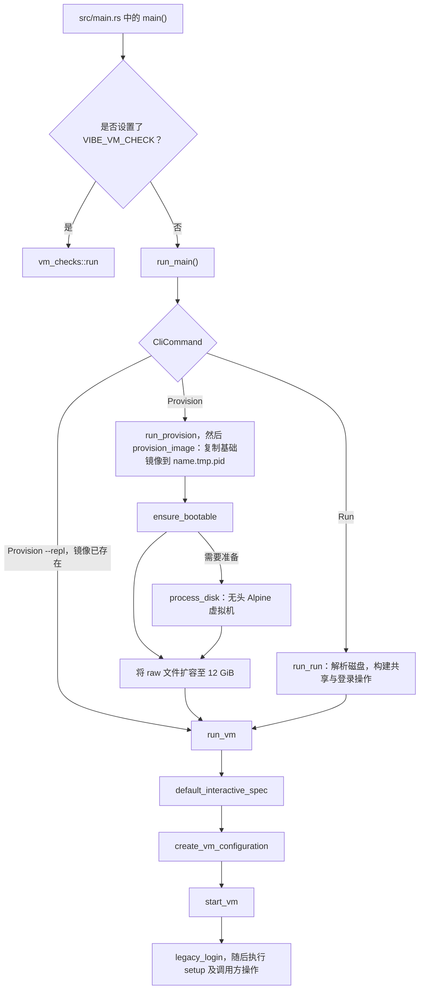

# 虚拟机如何启动

Vibe 提供了两个用于启动虚拟机的命令。`vibe`（以及 `vibe path/to/disk.raw`）将终端附加到现有的 raw 磁盘，并保持该文件不变。`vibe provision` 则将基础镜像复制到专用的工作文件中，可能对该副本进行一次性预处理，随后启动该副本、运行脚本，并将其发布为命名模板。

这两个命令最终都会进入相同的交互式启动流程：即 `src/vm_run.rs` 中的 `run_vm`。磁盘检查和 Alpine 维护虚拟机仅在启动前由 `provision_image`（`src/provision.rs`）在工作副本上执行。



Virtualization.framework 的完成处理程序（completion handler）在进程主线程上运行。因此，当设置了 `VIBE_VM_CHECK` 时，`main` 会在解析 CLI 之前调用 `vm_checks::run`。常规 CLI 从不设置该变量。`ensure_signed`（`src/signing.rs`）会检查 `com.apple.security.virtualization` 权限；如果缺失，则使用 `src/entitlements.plist` 对二进制文件执行 `codesign` 代码签名并重新执行。

## 磁盘文件

缓存目录（下文称“默认目录”）为 `$XDG_CACHE_HOME/vibe`；如果未设置 `XDG_CACHE_HOME`，则为 `~/.cache/vibe`。

`run_main` 在处理 `--version` 之后、`--help` 之前构造 `ImageDirs::from_env`（`src/image_dirs.rs`），因此除 `--version` 外，配置错误会让所有命令报错退出。`VIBE_EXTRA_IMAGE_DIR`（`:` 分隔的绝对路径）增加镜像目录，`VIBE_PREFERRED_IMAGE_DIR` 指定首选目录，它必须是默认目录或 extra 中的某一项，并且必须已经存在。查找顺序为：首选目录、默认目录、其余 extra 目录（按书写顺序）。比较时先去掉尾部 `/`，目录存在时再用 `canonicalize` 比较；重复项会被去掉。不存在的 extra 目录标注为 `(missing, skipped)`。run 与 provision 在 `ensure_signed` 之后打印一次 `ImageDirs::describe`；`--help` 在 `Cache directory:` 之后打印它。

镜像名（`--image`、`--base NAME`、`default`）通过 `find_named_image` 查找，Debian 基础镜像通过 `locate_debian_base` 查找。位置参数 `path/to/disk.raw`、含 `/` 的 `--base` 以及 `.vibe/instance.raw` 不参与查找。下表的“位置”列说明每个文件所在的目录。

| 文件 | 位置 | 创建者 | 作用 |
| --- | --- | --- | --- |
| `debian-13-nocloud-arm64-20261001-2618.tar.xz` | 首选目录 | `ensure_base_image` | 已下载的 Debian 基础归档包。仅在所有镜像目录都没有 `.raw` 时需要；不复用其他目录中的归档包。 |
| `debian-13-nocloud-arm64-20261001-2618.raw` | 第一个命中的目录，否则首选目录 | `extract_disk_raw` | 解压后的基础镜像。归档内的成员文件为 `disk.raw`。该文件从不被修改。 |
| `alpine-3.24.2-aarch64-tiny-r1.raw.tar.gz` 与 `.raw` | 第一个命中的目录，否则首选目录 | `ensure_alpine_image` | 固定版本的 Alpine 维护镜像。仅在工作副本需要预处理时下载。首选目录之外的 `.raw` 只有在 UUID 校验通过时才以只读方式复用。 |
| `alpine.lock` | 首选目录 | `FileLock::acquire` | 串行化 Alpine 的下载和解压流程。 |
| `<name>.raw` | 第一个命中的目录，否则首选目录 | `provision_image` | 已发布的模板。省略 `--image` 时使用的模板为 `default.raw`。`--replace` 在命中的目录原地替换。 |
| `<name>.tmp.<pid>` | 与 `<name>.raw` 同目录 | `provision_image` | 专用工作副本。仅在配置（provision）成功后才会重命名覆盖为 `<name>.raw`。 |
| `<name>.tmp.<pid>.lock` | 与 `<name>.raw` 同目录 | `FileLock::try_acquire_existing` | 维护虚拟机的同级锁文件。磁盘镜像本身不加 flock 锁，否则 Virtualization.framework 会拒绝附加该磁盘。 |
| `maint/<pid>-<nonce>/` | Alpine `.raw` 所在目录，否则首选目录 | `process_disk` | 单次维护运行环境：Alpine 克隆、seed ISO、EFI 变量存储、控制台日志。 |
| `logs/maint-<unix>-<pid>.log` | 默认目录 | `publish_log` | 已发布的维护控制台日志，开头带有列出完整路径的头部。仅保留最新的 5 个日志。 |
| `apt/`、`guest_node_modules/` | 默认目录 | `create_cache_shares`、`project_masks_and_shares` | 所有 `--vm-user` 共用的 VirtioFS 共享源目录，只在实际挂载时创建。 |
| `user-<name>/`：`mise-cache/`、`cargo/`、`yarn/`、`m2/`、`go/`；agent 配置（`codex/`、`copilot/` 等，仅在 `--mount-agents-conf` 时） | 默认目录 | `create_cache_shares` | `--vm-user` 为 `<name>` 时的用户缓存（默认为 `user-root/`），只在实际挂载时创建。旧的顶层目录（`cargo/`、`mise-cache/` 等）不再挂载；旧目录存在而新目录不存在时，`legacy_cache_notice` 打印提示，不移动也不删除旧目录。 |
| `vibe-usernet` | 默认目录 | `ensure_usernet_helper_extracted` | 内置的用户态网络辅助程序，在缓存字节不一致时写出。 |
| `.vibe/instance.raw` | 项目目录 | `ensure_instance_disk` | 项目专属磁盘，从模板复制一次生成。这是常规 `vibe` 启动的文件。 |
| `.vibe/vibe-usernet.log` | 项目目录 | `NetworkMode::prepare` | 项目实例的辅助程序日志。外部的 `path/to/disk.raw` 不会生成此日志。 |
| `$TMPDIR/efi_variable_store_<pid>.efivars` | `$TMPDIR` | `default_efi_vars_path` | 交互式虚拟机的 EFI 变量存储。每次启动时以 `AllowOverwrite` 重新创建。 |

### Debian 基础镜像

`src/images.rs` 中的 `DEBIAN_COMPRESSED_DISK_URL` 是 Debian 13 "trixie" nocloud arm64 镜像 `20261001-2618`。当 `.raw` 文件已存在时，`ensure_base_image` 会立即返回。否则，当归档文件缺失或小于 `DEBIAN_COMPRESSED_SIZE_BYTES` 时，它会通过 `curl` 下载，使用 `verify_sha512`（`/usr/bin/shasum`）校验 SHA-512，并通过 `extract_disk_raw` 解压（数据先写入同级临时文件，然后通过 `cache::replace` 替换）。失败信息会带上 `[download]` 前缀。

在未指定 `--base` 进行配置时，`run_provision`（`src/provision_command.rs`）会调用 `ensure_base_image`；在构建第一个 `default.raw` 之前，`ensure_default_image` 也会再次调用它。

### Alpine 维护镜像

`src/alpine.rs` 中的 `ALPINE_IMAGE_NAME` 是 `alpine-3.24.2-aarch64-tiny-r1`。归档的 URL 和 SHA-512 分别为 `ALPINE_ARCHIVE_URL` 和 `ALPINE_ARCHIVE_SHA512`。归档大小约为 66 MB。解压后的 raw 文件是一个约 1 GiB 的稀疏文件。

`ensure_alpine_image` 会持有 `alpine.lock`，随后执行 `ensure_locked`：

1. 损坏的归档会被删除，并通过 `images::fetch_verified` 重新获取（下载为 `.part`，校验 SHA-512，重命名）。
2. `extract_disk_raw` 发布 `{name}.raw`。
3. `alpine_root_uuid_matches` 要求分区 2（`ALPINE_ROOT_PART`）必须是 UUID 为 `ALPINE_ROOT_FS_UUID` 的 ext4。Alpine 通过标签 `/` 寻找自身的根目录。

如果存在有效的 raw 文件和有效的归档，则不会发起网络请求。缓存的 raw 文件作为只读输入。`run_maintenance` 通过 `cache::clone_file`（优先使用 APFS clone，失败时回退到复制）将其克隆到维护目录中，并启动该克隆副本。Alpine 镜像绝不会用作用户虚拟机的磁盘。被 `classify` 判定为兼容旧版（legacy compatible）的工作副本绝不会下载它。

### 命名模板与项目实例

`image_path` 将名称映射到 `{cache}/{name}.raw`。名称必须为 ASCII 字母数字以及 `-` 和 `_`（`assert_valid_image_name`）。

`provision_image` 按以下步骤构建模板：

1. 使用 `fs::copy` 将基础镜像复制到 `{name}.tmp.{pid}` 并赋予用户写入权限。基础镜像文件保持原样。
2. 保持副本的原始大小，在该副本上执行 `ensure_bootable`。如果预先扩容文件，会导致维护清单（manifest）与分区表不一致。
3. 如果副本小于 `DEFAULT_DISK_SIZE`（`DEFAULT_DISK_GB` 为 12，即 12 GiB），则通过 `set_len` 进行扩容。额外增加的字节为稀疏分配。
4. 启动该副本。若设置了 `--root-password` 或 `VIBE_ROOT_PASSWORD`，则在登录之后、`.profile` 与脚本之前用 `chpasswd` 写入该密码。随后运行脚本。`provisioning/base.sh` 始终是第一个脚本。它安装基础软件包，然后运行 `growpart /dev/vda 1` 和 `resize2fs /dev/vda1`。
5. 清空 `/etc/machine-id`，通过 `probe_disk` 确认清空，然后通过 `fs::rename` 将工作副本重命名为 `<name>.raw`。

`ensure_default_image` 会针对 `default.raw` 配合所有内置脚本执行一次此流程。已存在的 `default.raw` 会被立即返回，且不会再次探测。在没有实例磁盘的项目中，当 `--image` 为 `default`（或省略）时，首次执行普通的 `vibe` 会调用 `ensure_default_image`。

当 `.vibe/instance.raw`（`INSTANCE_DIR_NAME`，`INSTANCE_DISK_IMAGE_NAME`）不存在时，`ensure_instance_disk` 会将所选模板复制到该文件。后续运行则直接按原样启动该实例。一旦 `.vibe/instance.raw` 存在，`vibe --image NAME` 参数将被忽略（当 `NAME` 不是 `default` 时，`run_run` 会打印提示信息）。

位置参数指定的 `path/to/disk.raw` 会直接按原样启动（`DiskSource::External`）。它不会创建 `.vibe/instance.raw`，也不会读取缓存模板。

每个发布的镜像都具有空的 `/etc/machine-id`。因此，每个实例都会在首次启动时生成自己的 machine id，并在重启后保持不变。root 密码字段保持为空，除非发布该镜像的 provision 给出了 `--root-password` 或 `VIBE_ROOT_PASSWORD`。在这种情况下，同一密码会在脚本运行前被设置。

## 从 CLI 到运行中的客户机

### `run_main`

`parse_cli`（`lexopt`）用于填充 `CliArgs`。`run_main` 负责创建缓存目录，调用 `ensure_signed`，并准备一个包裹 `NetworkMode::prepare` 的闭包。它把两个命令共用的值放进 `CommandContext`，再调用 `run_run`（`src/run_command.rs`）或 `run_provision`（`src/provision_command.rs`）。各命令自行构建缓存共享：`cache_share_specs(sys_cache, mise, agents_conf)` 按 `MISE_CACHE_SHARE`、`SYS_CACHE_SHARES`、`AGENT_CONF_SHARES` 的顺序选取，`create_cache_shares` 只创建这些宿主机目录。每个 `CacheShare` 为 `Global`（`apt`，位于 `<cache>/apt`）或 `User`（位于 `<cache>/user-<vm-user>/<name>`）。进入各命令分支之前，如果将要挂载的用户缓存有旧的顶层目录而没有新目录，`legacy_cache_notice` 打印一次提示。

在调用 `run_vm` 之前，run 与 provision 都会打印 `describe_vm_files`：目录共享（`host -> guest (mode)`）以及 Vibe 写入 VM 的文件，没有时打印 `(none)`。运行计划设置了 `restrict_apt_cache` 时，apt 缓存的模式显示为 `read-write, read-only for <user> via bindfs if the image has it`。

在 `nat` 模式下，`guest_proxy` 为 `None`：`vibe-usernet` 辅助程序自身会应用 `--proxy`，因此客户机不会额外接收代理环境变量。在 `vznat` 模式下，`--proxy` 的 URL 会被传递到配置脚本和登录环境变量导出中。

### Run 命令

`run_run` 中的 `CliCommand::Run` 处理流程如下：

1. 按照上文所述解析磁盘。`DiskSource` 为 `External` 或 `Instance`。仅针对实例磁盘时，网络日志目录才为 `.vibe/`。
   使用默认镜像且 `default.raw` 尚不存在时，`check_implicit_provision` 先拒绝 `--no-mount-sys-cache` / `--no-mount-mise`（错误中列出这些选项、`default.raw` 的路径以及 `vibe provision` 的用法），此时 `ensure_default_image` 尚未查找或下载任何东西。`ensure_default_image` 接收缓存目录，只在需要 provision 时才创建共享，并且总是使用 `cache_share_specs(true, true, false)`。
2. 除非指定了 `--no-mount-cwd`：将项目目录共享到 `--vm-user` 的 HOME 下的 `<project>`（root 为 `/root/<project>`；`is_project_dir`）并 `cd` 进去。`--mount` 共享同样是 `is_project_dir`。客户机路径是 `GuestPath`（`src/vm_user.rs`）：绝对路径，或相对于该 HOME 的路径。对 root，相对路径展开为 `/root/<path>`；对其他用户展开为 `"${VIBE_VM_HOME}"/<path>`。`project_masks_and_shares` 处理每个项目目录：使用 tmpfs 遮蔽 `.vibe`；当宿主机目录存在时从缓存共享 `node_modules`；根据 `--git` 参数共享或遮蔽 `.git`（默认为只读；如果是子模块中的 `.git` 文件则跳过）。`.env` 等文件不再被遮蔽。然后追加 `cache_share_specs(mount_sys_cache, mount_mise, mount_agents_conf)`：apt 仍在 `/var/cache/apt`，其他缓存相对于 HOME（`.cargo`、`.local/share/mise` 等）；Agent 配置目录（`codex`、`copilot`、`claude`、`gemini`、`pi`、`grok`、`opencode`）仅在 `--mount-agents-conf` 时追加。指定 `--mount-tmux-conf` 时，`tmux_conf_mounts` 在 `~/.tmux` 为目录时将其只读共享到 `.tmux`，并在宿主机存在 `~/.tmux.conf` 时排队一个 `Send` 动作，把它写入用户 HOME 下的 `.tmux.conf`（`write_user_file_into_vm`；非 root 用户由该用户经 `runuser` 自己写入）；两者都不存在时打印警告。
3. `run_session_plan` 构建一个 `SessionPlan`（`src/session_plan.rs`）。其 `root_prepare` 检查非 root 的 `--vm-user`（`check_vm_user_actions`，见下文）。其 `root_actions` 依次为 tmux 的 `Send`、`--write-bashrc`（root 使用 `write_bashrc_actions`：把 `src/bashrc.sh` 写入 `/root/.profile`，随后执行 ` . /root/.profile`；其他用户使用 `write_user_bashrc_action` 写入该用户的 `~/.profile`，由 `su --login` 读取；未指定时不写也不 source `.profile`），以及 `--ssh-key` 命令（用户的 `authorized_keys`，非 root 用户经 `runuser` 写入；`systemctl start ssh`；`ip -4 -br addr`）。非 root 用户会设置 `switch_user`，会话在 `root_actions` 与 `user_actions` 之间切换到该用户（见下文）。其 `user_actions` 依次为 `cd` 进项目、宿主机的 `--env` 导出变量（`env_login_actions`）、`HISTFILE`、共享目录表（`motd_login_action`，非 root 用户显示为 `~dev/proj` 之类的路径）、设置了 `guest_proxy` 时的代理导出，最后是用户的 `--script`、`--send` 和 `--expect` 动作。`numbered` 记录了用户动作的索引范围，以便后续报错时仅针对这些动作编号。非 root 用户会设置 `restrict_apt_cache` 和 `warn_passwordless_root`。
4. 打印 `describe_vm_files("Run", ...)`（`/root/.bash_logout`，以及写入时用户 HOME 下的 `.profile`、`.tmux.conf`）；指定 `--no-mount-mise` / `--no-mount-sys-cache` 时打印共享目录中的工具不可用的提示。调用 `run_vm`。

root 的所有动作都在 root shell 中运行，没有切换。其他用户的 `user_actions`（包括 `--send`、`--expect` 和 `--script`）在该用户的 shell 中运行。

### Provision 命令

`run_provision` 中的 `CliCommand::Provision` 处理流程如下：

- 缓存共享为 `cache_share_specs(mount_sys_cache, mount_mise, false)`。指定 `--no-mount-sys-cache` / `--no-mount-mise` 时打印提示：工具会装进镜像自身，运行该镜像时需要使用同样的选项才能看到它们。
- 非 root 的 `--vm-user` 而没有 root 密码（`--root-password` 或 `VIBE_ROOT_PASSWORD`）时，在复制或启动任何东西之前报错（`check_provision_root_password`）：否则该用户可以用 `su -` 成为 root。
- 带 `--repl` 且镜像已存在、同时未指定 `--replace` 时，打印一行提示和共享日志（`Provision`），并对该镜像调用 `run_vm`（`DiskSource::CachedImage`），动作来自 `existing_image_repl_actions`（root：`write_bashrc_actions`；其他用户：只有 `write_user_bashrc_action`）。非 root 的 `--vm-user` 由 `check_vm_user_actions` 检查（从不创建），适用 root 无密码的警告，会话会切换到该用户，并提示 `exit` 返回 root shell。不运行任何脚本，也不探测该镜像。
- 否则解析 `--base`。包含 `/` 的值表示文件系统路径。不含 `/` 的值代表缓存中的 `image_path`。未指定 `--base` 时，由 `ensure_base_image` 提供 Debian raw 镜像。
- 调用 `provision_image`。

除非指定了 `--replace`，否则 `provision_image`（`src/provision.rs`）会拒绝覆盖已存在的 `<name>.raw`。它会复制基础镜像，调用 `ensure_bootable`，扩容文件，随后由 `build_provision_plan` 构建 `SessionPlan`。其 `root_prepare` 在共享挂载之前运行：给出密码时先执行 `set_root_password_actions`，然后对非 root 的 `--vm-user` 执行 `ensure_vm_user_actions`（`src/guest/ensure_vm_user.sh`：账号不存在时执行 `useradd --create-home --home-dir /home/<name> --shell /bin/bash --user-group <name>`；已有账号保持不变），之后做与 run 相同的检查。共享与 run 一样挂载在该用户的路径下。其 `root_actions` 以 `install_bindfs_action` 开头（标签为 `install bindfs` 的 `StatusCommand`；`apt-get install bindfs`，`vznat` 的客户机代理直接传给 apt），使任何镜像之后都能以非 root 的 `--vm-user` 运行。然后是 `write_bashrc_actions`：把 `src/bashrc.sh` 写入 `/root/.profile` 并 source，使 PATH 与 mise 激活对脚本生效，该文件也随镜像保存（此处的错误显示为 `[login] setup send`）。非 root 的 `--vm-user` 也会得到同样内容的 `.profile`（`write_user_bashrc_action`）。然后：

1. 一个导出 `VIBE_PROVISION_IMAGE`、`VIBE_PROVISION_BASE`、`VIBE_GIT_SHA`、`VIBE_BUILD_DATE`、`VIBE_PROVISION_SCRIPTS` 和 `VIBE_PROVISION_VM_USER` 的 `Send` 动作（`provisioning/base.sh` 把它作为 `vm_user:` 记入 provision 历史）。
2. 脚本动作：首先是来自 `build_provision_script` 的 `@base`（如果设置了 `guest_proxy`，则填充 `provisioning/base.sh` 中的 `INJECT_PROXY_CODE` 区域），然后是其他额外脚本。此范围是计划中的 `numbered`，因此脚本执行失败会显示为 `[action N: script '...']`。root，以及所有非内置脚本，每个脚本是一个由 root 运行的 `Script`（自定义脚本可以看到 `VIBE_VM_USER` 与 `VIBE_VM_HOME`）。非 root 用户时，内置脚本在 `# vibe:run-as-user` 一行处拆分（`split_run_as_user`）：之前的部分是由 root 运行的 `Script`（没有命令时跳过），之后的部分加上 shebang 行，是以该用户运行的 `UserScript`。每部分自带 `set -euxo pipefail` 与辅助函数。`@base` 只在镜像第一次 provision 时安装 mise：root 部分创建 `/run/vibe/base-first-run`，用户部分在该文件不存在或 `~/.local/state/vibe/base-user.done` 已存在时直接结束。之后再 provision 一个没有该标记的镜像时，会打印用户级工具缺失的警告。
3. 非 root 用户时执行 `check-vm-user-home`：一个 root `Script`，当用户 HOME（同一文件系统内，跳过挂载点）中有属主为 root 的文件时失败，以免本应属于用户的工具被 root 安装。它的失败显示为 `[shutdown]`。
4. `finalize-machine-id`。未指定 `--repl` 时，执行 `CLEAR_MACHINE_ID_SCRIPT`，它会拒绝挂载覆盖（mount overlay）或符号链接，并截断清空 `/etc/machine-id` 及常规的 `/var/lib/dbus/machine-id`。指定了 `--repl` 时，执行 `REPL_FINALIZE_SCRIPT`：在 `/run` 下创建一个临时的 `vibe-finalize-template` unit，在关机时清空 id，以便当前打开的 shell 仍保留 systemd 在启动时写入的 id。
5. 针对 `VIBE_PROVISION_SUCCESS` 的 `Send` / `Expect` 动作。
6. 未指定 `--repl` 时，执行 `systemctl poweroff; sleep 100`。指定了 `--repl` 时，`run_vm` 会打印交互提示并等待用户退出。`--repl` 且为非 root 用户时，计划设置 `switch_user`，shell 是该用户的；`exit` 返回 root，在 root 中再 `exit` 关机并保存镜像。

调用 `run_vm` 之前会打印 `describe_vm_files(stage, ...)`（`Provision`，或由 `ensure_default_image` 传入的 `Provision (implicit, for the default image)`）以及调用方传入的提示。调用 `run_vm` 时传入 `disk_source: None`，因此本次启动失败不会追加“配置此磁盘（provision this disk）”的提示。虚拟机停止后，如果动作未完成或最终状态不是 `Stopped`，`incomplete_run_error` 会拒绝该次运行。随后 `probe_disk` 必须报告 `MachineIdFact::EmptyFile`，否则会报错 `[verify]` 且镜像不会被发布。最后通过 `fs::rename` 发布该工作副本。

除非设置了 `VIBE_KEEP_FAILED_WORK=1`，否则任何错误都会删除 `<name>.tmp.<pid>`。失败的配置绝不会发布残缺的镜像。`failed_work_message` 会打印保留的路径，或提示你设置该环境变量。

## 交互式启动

`run_vm` 打印磁盘、CPU 核心数和内存大小，然后调用 `drive_interactive`。对于普通运行，默认配置为 2 核 CPU 和 2048 MiB 内存（`DEFAULT_CPU_COUNT`，`DEFAULT_RAM_BYTES`）。配置流程默认使用 2 核 CPU 和 4096 MiB 内存（`DEFAULT_PROVISION_RAM_BYTES`），除非显式设置了 `--cpus` 或 `--ram`。

### 配置与启动

1. `create_pipe`（`src/vm_io.rs`）构建三对套接字：客户机读取的字节（宿主机按键和输入的动作）、客户机写入的字节（控制台输出），以及客户机在第二个串口上读取的终端窗口调整大小字节。
2. `prepare_network_backend` 调用 `NetworkMode::prepare`（`src/networking.rs`）。`nat` 模式会解压 `vibe-usernet`，通过数据报套接字对和存活管道启动它，并返回 `PreparedNetworkBackend::Usernet`。`vznat` 模式返回 `PreparedNetworkBackend::VzNat` 且不启动辅助程序。传入日志目录时，辅助程序的 stderr 会输出到 `vibe-usernet.log`。
3. `default_interactive_spec`（`src/vm_config.rs`）构建一个 `VmSpec`：一个可写的 `DiskSpec`（客户机 `vda`）、网络后端、存在共享目录时打上 `shared` 标签（`SHARED_DIRECTORIES_TAG`）的 VirtioFS 设备、串口角色先为 `Terminal` 后为 `Resize`、临时 EFI 存储路径，以及 CPU 和内存大小。串口顺序与客户机内部顺序一致：`hvc0` 为控制台，`hvc1` 为窗口大小调整通道。
4. `create_vm_configuration` 将该规格转换为 `VZVirtualMachineConfiguration`：
   - `VZGenericPlatformConfiguration` 与 `VZEFIBootLoader`。仅支持 EFI 引导。
   - `load_efi_variable_store` 创建变量存储。
   - Virtio 网络：在 usernet 套接字上绑定 MAC 地址为 `USERNET_MAC_ADDRESS` 的 `VZFileHandleNetworkDeviceAttachment`，或者使用 `VZNATNetworkDeviceAttachment`。
   - `VZVirtioEntropyDeviceConfiguration`。
   - 每个磁盘对应一个 `VZVirtioBlockDeviceConfiguration`（`VZDiskImageCachingMode::Cached`，`VZDiskImageSynchronizationMode::Full`）。
   - 用于共享目录的 `VZVirtioFileSystemDeviceConfiguration` / `VZMultipleDirectoryShare`。
   - 每个串口对应一个 `VZVirtioConsoleDeviceSerialPortConfiguration`。
   - `validateWithError`。磁盘缺失会在 `initWithURL` 中失败，并由 `disk_attachment_error` 进行报告。
5. `start_vm`（`src/vm_lifecycle.rs`）在主调度队列上创建 `VZVirtualMachine`，调用 `startWithCompletionHandler`，并持续驱动 `NSRunLoop`，直到处理程序触发或超时 `START_TIMEOUT`（60 秒）。

在 `drive_interactive` 中，`create_vm_configuration` 和 `start_vm` 的错误会加上 `[boot]` 前缀。随后宿主机打印 `VM booting...`。

### 控制台 I/O 与登录线程

`spawn_vm_io` 启动终端线程。客户机的输出会被复制到宿主机终端并输入到 `OutputMonitor`（`wait_for_text`、`wait_for_any`、`wait_for_line_after` 返回 `Found`、`Timeout` 或 `Closed`）。stdin 线程调用 `decide_user_input`：在 `input_open` 设置之前按键会被丢弃，在输入门控关闭时连续按下两次 Ctrl-C 会设置 `stop_requested`。当宿主机终端大小改变时，resize 线程会向 `hvc1` 写入 `rows cols`。

`drive_interactive` 通过 `expand_session`（`src/session_plan.rs`）构建完整的动作列表：

1. `legacy_login_prefix(LOGIN_EXPECT_TIMEOUT, root_password)`，其中 `LOGIN_EXPECT_TIMEOUT` = 120 秒。`root_password` 来自 `--root-password`；未给出该选项时来自 `VIBE_ROOT_PASSWORD`。
2. 计划中的 `root_prepare`：root 密码，然后是 `--vm-user` 步骤。对非 root 用户，该步骤导出 `VIBE_VM_USER`、`VIBE_VM_UID`、`VIBE_VM_GID` 和 `VIBE_VM_HOME`，供后续路径与挂载使用。
3. 存在共享目录时：执行 `mkdir -p /mnt/root/virtiofs-shared && chmod -R 700 /mnt/root && mount -t virtiofs shared /mnt/root/virtiofs-shared`，使 staging 目录只有 root 能到达。然后为每个共享创建目标并把 staging 子目录 `mount --bind` 上去。在非 root 用户的 HOME 下，每个缺失的目录用 `install -d -o "$VIBE_VM_UID" -g "$VIBE_VM_GID"` 逐级创建。设置 `restrict_apt_cache` 时，apt 缓存是一个标签为 `mount apt cache` 的 `StatusCommand`：`bindfs -u _apt -g 0 -p 0755,af-x`，文件显示为 `_apt` 所有，其他用户只能读不能写，root 的 apt 仍下载到宿主机缓存中。缺少 `bindfs` 或 `_apt` 账号时（例如 Vibe 开始安装 `bindfs` 之前 provision 的镜像），回退为可写的绑定挂载，宿主机打印警告并建议重新 provision 或使用 `--no-mount-sys-cache`。共享的读写权限由谁决定、为什么这样，见 [file-shares-between-vm.md](file-shares-between-vm.md)（英文）。
4. 遮蔽：`mount -t tmpfs -o mode=0555,uid=0,gid=0 tmpfs <path>`，一个属于 root、其他用户无法写入的空目录。
5. 调用方动作：计划中的 `root_actions`，然后（设置了 `switch_user` 时）是切换，再是 `user_actions`。切换先键入 ` sysctl -q -w dev.tty.legacy_tiocsti=0 2>/dev/null || true`，使用户的程序不能把输入塞回 root shell 的终端；然后 `LoginAction::SwitchUser` 键入 `SWITCH_USER_COMMAND`：` su --login --pty "$VIBE_VM_USER"; echo; echo 'Vibe: back in the root shell. ...'`。root shell 读取的是整行，所以提示只在用户的 shell 退出后出现。`su` 关闭用户终端时发送的输入会丢失，所以登录动作在 `--send exit` 之后要用 `--expect` 等待这条提示。随后发送一个与 root 就绪探测相同方式的探测（拆分的标记，然后是 `id -un` 与 `id -u`），每 10 秒重试，最长 120 秒；结果必须是该用户名且 uid 不为 0，否则报错 `LoginFailure::SwitchFailed`（`[login] Switching to vm-user ...`）。切换动作标记为 `[login] setup`。
6. 尾部两个 `Send` 动作：当命令存在时激活 `mise` 和 `fzf`。

`StatusCommand` 把命令放在一个 stdin 来自 `/dev/null` 的命令组中运行（这样 apt-get 之类的工具无法吃掉其后输入的行），然后打印 `VIBE_STEP_STATUS_<id>` 及 `<退出码> <notice>`。非零退出码使该动作失败。非空的 `__vibe_notice` 会成为 `VmOutput::Notice`，由 `drive_interactive` 打印为警告（例如 `--vm-user` 属于 `sudo` 或 `adm` 组）。

`action_prefix` 标记每个索引。用户范围内的动作用 `[action N: ...]` 标记，从 1 开始计数。该范围之后的调用方动作（provision 的收尾与关机）标记为 `[shutdown] ...`。调用方范围之前的动作以及位于其后的尾部 `mise` 和 `fzf` 发送动作均标记为 `[login] setup ...`。`Send` 动作的 `LoginAction::label` 为单词 `send`，不包含实际输入的文本。

`spawn_login_actions_thread`（`src/session/actions.rs`）在后台线程上运行该列表，并通过通道报告 `VmOutput`。主线程每 0.2 秒轮询驱动一次运行循环，应用这些消息，并在动作失败或设置了 `stop_requested` 时调用 `request_stop`（错误提示为 `[shutdown] Stopped because Ctrl-C was pressed twice before setup finished.`）。`request_stop` 优先使用 `canRequestStop`，回退时使用 `stopWithCompletionHandler`。`VIBE_FORCE_STOP_AFTER_LOGIN=1` 是一个测试钩子：在 `LoginReady` 之后，`force_stop` 会使客户机文件系统保持未正常卸载的脏状态。

当虚拟机离开 `Running` 状态或收到停止请求时，`output_monitor.close()` 会解除动作线程的阻塞。`drive_interactive` 等待其汇合（join），关闭 I/O 线程并返回。如果始终未达到 `LoginReady`，错误为 `LoginFailure::VmStopped`（`[boot] The VM stopped before the root login completed`）。`RunOutcome` 记录了是否所有动作均已完成、最终状态是否为 `Stopped`，以及当时仍在运行的调用方动作的前缀。

### 旧版 root 登录流程

`legacy_login` 实现了 `LoginAction::LegacyLogin`。这是唯一的登录路径，不存在 cloud-init 通道。

1. `wait_for_text("login: ", timeout)`。`hvc0` 上为零字节则返回 `LoginFailure::NoSerialOutput`。其他超时则返回 `NoLoginPrompt`。两者均显示为 `[boot]`。
2. 输入 `root`。
3. 在 `Password:`、`Debian GNU/Linux` 和 `login: ` 中执行 `wait_for_any`。超时则为 `NoBanner`。
   - 出现 `Password:` 且未提供密码时，为 `LoginFailure::PasswordRequired`：`[login] The image asks for a root password (disk: ...). Pass --root-password to log in.`
   - 出现 `Password:` 且已提供密码时，键入该密码。密码不会被记录。下一步在 `Login incorrect`、`Debian GNU/Linux`、`Last login` 和 `login: ` 中等待。`Login incorrect` 或再次出现 `login: ` 为 `AuthFailed`：`[login] root authentication failed with the given --root-password (disk: ...)`。超时为 `AuthTimeout`：`[login] Sent the root password but saw neither a successful login nor 'Login incorrect' within {timeout:?} (disk: ...)`。其他匹配则继续就绪探测。
   - 其他匹配不会键入密码，直接进入就绪探测。
4. 输入就绪探测命令。`readiness_probe_command_and_marker` 构建一个 `printf` 命令，其标记 `VIBE_READY_<nonce>` 被拆分在两个参数中，从而确保回显的命令行本身不包含完整标记。下一行必须是 `id -u` 且结果等于 `0`。其他任何情况均为 `ProbeTimeout` 或 `ProbeNotRoot`（`[login]`）。

当探测返回 uid 0 时发送 `LoginReady`。若客户机要求密码且密码被接受，其中会记录 `password_prompted`。该值为 false 且计划设置了 `warn_passwordless_root`（以非 root 的 `--vm-user` 进行 run 或对已有镜像 `--repl`）时，`drive_interactive` 打印 `Warning: root has no password in this image; user '<name>' can become root with 'su -'. ...` 并继续运行。在 `ActionsCompleted`（即 setup 发送、共享挂载和调用方动作均完成）之前，`input_open` 始终为 false。在此之前，键盘输入均会被丢弃。

`legacy_login_prefix` 内的 setup 发送动作包括：`HISTCONTROL=ignorespace` 和 `unset HISTFILE`（使自动执行的命令不计入历史记录）、`stty -F /dev/hvc0 sane`、一个从 `/dev/hvc1` 读取 `rows cols` 并应用到 `hvc0` 的后台循环，随后通过 `write_file_into_vm` 将 `src/bash_logout.sh` 写入 `/root/.bash_logout`。它从不写入或 source `/root/.profile`；provision 与 `--write-bashrc` 改为在调用方的动作中加入 `write_bashrc_actions`。注销脚本在正常退出时会运行 `systemctl poweroff`。如果 shell 属于 SSH 会话、位于 tmux 内、tmux 存在活动会话，或有任何 tmux 服务器进程在运行（`pgrep '^tmux: server'`，匹配 tmux 为服务器进程设置的进程名；root 的 `tmux list-sessions` 看不到其他用户的服务器），则跳过关机。

`Script` 动作（`script_command`）将内容 base64 解码到 `/tmp/vibe-scripts-<uid>/<id>.sh`，在 stdin 重定向自 `/dev/null` 的情况下运行该文件，并等待 `VIBE_SCRIPT_STATUS_<id>` 及其退出码。该目录以 0700 权限创建；已存在的目录只有在是当前用户拥有的真实目录时才会复用，否则动作失败。只有 uid 0 才会在脚本前清空页缓存。非零状态视为 `LoginActionFailed`。脚本超时时间为 24 小时。

`UserScript` 动作使用同一个包装，并设置 `as_vm_user`。root 以 0700 创建 `/tmp/vibe-scripts-$VIBE_VM_UID` 并交给该用户（已存在的目录只有在是属于该 UID 的真实目录时才复用）。文件由该用户经 `runuser` 写入，因此其中的符号链接不能让 root 写到别处。脚本随后在用户 HOME 中以 `runuser -u "$VIBE_VM_USER" -- env ... HOME=... USER=... LOGNAME=... SHELL=/bin/bash bash --login -c 'exec "$0"' <file>` 运行：不带 `--login` 的 `runuser` 保留 root 导出的变量（`vznat` 的代理、`VIBE_PROVISION_*`），`env -u` 去掉 root 的 mise 会话变量，登录 shell 读取用户的 `.profile` 后再 `exec` 脚本。必须 `exec`：登录 shell 退出时会执行 `~/.bash_logout`，Debian 默认的该文件最后执行 `clear_console`，其退出码会取代脚本的退出码。

### vm-user 检查

`check_vm_user_actions`（`src/vm_user.rs`）以标签为 `check vm-user` 的 `StatusCommand` 运行 `src/guest/check_vm_user.sh`。退出码 10 到 15 分别表示：账号不存在、UID 为 0、登录 shell 不是 bash、HOME 不是可用的目录、HOME 不属于该账号、HOME 为 `/root`。`drive_interactive` 把它们转为 `LoginFailure::VmUser`：`[login] vm-user '<name>' ...`。账号不存在时建议 `vibe provision --base <disk> --image <new-name> --vm-user <name>`；其他问题说明 Vibe 不修改已有账号。检查成功时，若账号属于 `root`、`sudo`、`adm`、`wheel` 或 `admin` 组，脚本输出 `groups=<list>`，宿主机将其打印为警告。root 跳过该检查。

### 启动失败提示

在无输出、缺少 `login:` 提示符以及虚拟机在登录前停止的情况下，`suggests_provision` 为 true。`PasswordRequired`、`AuthFailed` 和 `AuthTimeout` 不会建议 `vibe provision`。当 `disk_source` 为 `Some` 且 `suggests_provision` 为 true 时，`needs_provision_hint` 会追加一条 `vibe provision` 命令提示。措辞保持推测性：因为运行路径并未对磁盘进行实际检查。

- `DiskSource::External`：提示 `vibe provision --base <absolute disk> --image <name>`，随后在项目中运行 `vibe --image <name>`。
- `DiskSource::Instance`：同样的 provision 命令，随后移走 `.vibe/instance.raw` 并运行 `vibe --image <name>`，以便从处理好的镜像中复制出新实例。
- `DiskSource::CachedImage`：提示 `vibe provision --base <name> --image <new-name>`，或执行 `vibe provision --image <name> --replace` 从 Debian 基础镜像重新构建该名称。

未经处理的新版 Debian 磁盘不会产生任何控制台输出（卡在初次启动向导中），并在 120 秒后触发 `NoSerialOutput`。`[boot]` 错误会包含上述命令建议。

## 配置过程中的磁盘预处理

`ensure_bootable`（`src/disk_prepare.rs`）是配置路径上对 Alpine 虚拟机的唯一调用方。

### 宿主机分类检查

`probe_disk`（`src/image_probe.rs`）始终会返回一个分类。它在宿主机上使用 `pread` 读取文件。`gpt::read_gpt` 和 `gpt::select_layout` 要求必须具有一个 EFI 系统分区和一个根分区：存在 ARM64 根分区类型 `LINUX_ROOT_ARM64_GUID` 时采用该类型，否则采用单个 `LINUX_FILESYSTEM_GUID` 分区。`Ext4Ro` 读取 `/etc/os-release`（支持单层词法符号链接；Debian 的 `/etc/os-release` 指向 `../usr/lib/os-release`）、`/etc/debian_version`、`/etc/machine-id`、`/etc/shadow` 和 `/var/lib/dbus/machine-id`。解析 shadow 字节以获取 root 密码字段后立即清零。这些信息不会保存在 `ProbeFacts` 中。`VIBE_TRACE_PROBE=1` 会记录每个 `probe_disk` 路径。普通运行路径从不设置该变量，也从不调用 `probe_disk`。

`classify` 随后调用 `prepare_decision`：

| `ImageClass` | 决策 | 处理操作 |
| --- | --- | --- |
| `LegacyCompatible` | `AlreadyCompatible` | 打印 `Disk is already legacy compatible; skipping Alpine preparation.`。系统为 Debian，machine-id 缺失、为空文件或为有效的 32 位十六进制 id，且仅有一行 `root:` shadow 记录且密码字段为空。 |
| `Unsupported` | `WarnUnsupported` | `unsupported_warning` 打印 `[probe] Warning: ...`，且副本仍会在旧版登录路径上尝试启动。这对应 `no GPT root`，或 ext4 根分区中的 `os-release` 非 Debian（`ID=debian` 或 `ID_LIKE` 包含 `debian`）。此类磁盘通常无法登录成功。 |
| `NeedsPreparation` | `Process` | machine-id 内容为 `uninitialized\n` 或其他内容，或者 root 密码字段不为空。`preparation_notice` 会指出这些原因，并提示该步骤大约需要 20 秒。 |
| `Unknown` | `Process` | 有界读取器无法做出判定（不可读的文件系统、`needs recovery`、machine-id 符号链接、异常的 root 记录行数等）。交由 Alpine 自行检查镜像。 |

在预处理前会打印 `EMPTY_ROOT_NOTICE`：在此操作后，该镜像及其衍生的虚拟机中的 root 密码均为空。

### 维护虚拟机

`process_disk`（`src/maintenance.rs`）：

1. `prepare_target` 要求目标为常规可写文件。它以读写模式打开磁盘仅为验证其可写性，随后获取同级 `{disk}.lock` 上的非阻塞 flock。它读取 GPT、选择布局并执行 `scan_labels`。`label_block_reason` 会拒绝 ext4 UUID 等于 `ALPINE_ROOT_FS_UUID` 以及文件系统标签为 `/` 或 `cidata`（不区分大小写）的磁盘。它会记录 `ProbeFacts` 以供后续复检。
2. `create_work_dir`：`cache::private_dir` 在 Alpine `.raw` 所在目录下以权限 `0700` 创建 `maint/<pid>-<nonce>`，让克隆在同一文件系统内完成。创建失败时（例如只读卷）打印一行说明，改用首选目录下的 `maint/`。随后 `cache::sweep_stale` 只清理实际使用的 `maint/` 根目录下 `<pid>-<nonce>` 对应 pid 已不存在的废弃目录。
3. `run_maintenance`：
   - 生成 `control::new_nonce`（32 位小写十六进制数字）。
   - 将 Alpine raw 克隆到该目录下的 `alpine.raw`。
   - 构建 `seed::Manifest`：版本为格式 1，包含 nonce、Alpine 根分区 UUID、工作副本字节大小、根分区索引、PARTUUID、类型 GUID、ESP 索引以及 `policy=minimal`。`Manifest::serialize` 会拒绝任何其他格式。
   - `seed::build_seed` 写入 `meta-data`、`user-data`（内嵌的 `src/guest/maint.sh`）和 `manifest`，然后使用 `hdiutil makehybrid` 创建卷名为 `cidata` 的 ISO。该 ISO 必须非空且小于 8 MiB。
   - 按照客户机顺序配置 `VmSpec` 磁盘：`vda` 为 Alpine 克隆（可写），`vdb` 为 Debian 工作副本（可写），`vdc` 为 `seed.iso`（只读）。`network` 设为 `None`。无共享设备，无键盘串口。`hvc0` 为 `SerialRole::Log`，`hvc1` 为 `SerialRole::Control`（`output_serial` 保留宿主机读取端）。EFI 变量保存在工作目录下的 `efivars`。配置为 2 核 CPU 和 1 GiB 内存（`MAINT_CPU`，`MAINT_RAM_BYTES`）。
   - `run_headless` 启动该规格。日志工作线程将 `hvc0` 复制到 `hvc0.log`。控制工作线程将 `hvc1` 传递给 `FrameReader::new(nonce)`。接收到的每个有效帧都会传递给 `observe_frame`。
4. 成功后，`image_probe::verify_processed` 重新读取工作副本。要求 GPT 布局未改变、`/etc/machine-id` 为空常规文件、恰好有一行密码字段为空的 root shadow 记录、dbus machine-id 缺失、为空或者是指向 `/etc/machine-id` 的符号链接，且 `classify` == `LegacyCompatible`。失败则报错 `[verify] host-verify`。
5. `publish_log` 将控制台日志写入默认目录下的 `logs/maint-<unix>-<pid>.log`，并在前面加上 `log_header`，列出被处理磁盘、Alpine 源 `.raw`、Alpine 克隆、seed ISO 和工作目录的完整路径；`retain_newest_logs` 保留 `LOGS_TO_KEEP`（5 个）。除非设置了 `VIBE_KEEP_FAILED_WORK=1`（此时会打印路径），否则工作目录会被删除。保留的目录在对应 pid 退出后，仍会被下一次 `process_disk` 删除。随后 `ensure_bootable` 会解绑并删除同级 `.lock` 文件，除非错误原因是另一个 Vibe 进程正持有该锁。

发生 `PrepareError` 时会打印 `[prepare] <stage> (last PREP-STEP: ...)` 以及日志路径。宿主机复检失败使用 `[verify]` 前缀。

### 客户机脚本执行流程

`src/guest/maint.sh` 为 NoCloud 的 `user-data`，由 tiny-cloud 执行。它将控制台输出写入 `hvc0`，并将控制帧以 `VIBE1 <nonce> <kind> ...` 格式（`control::Frame`，最大 `MAX_FRAME_LEN` 字节）写入 `hvc1`。宿主机不发送任何帧。nonce 仅用于将日志行与本次运行绑定，并非鉴权凭据。

`mount_seed` 挂载 `LABEL=cidata` 并要求设备必须是 `/dev/vdc`。无法挂载 seed 则不会发出任何帧。随后 `parse_manifest` 发出 `PREP-READY`。

`MAINT_STEPS` 和脚本严格按以下顺序运行。`observe_frame` 会拒绝任何其他顺序。客户机返回 `PREP-RESULT fail` 时会附带来自 `step_code` 的步骤错误码，并自行关闭虚拟机。只有协议或步骤顺序错误才会导致 `decision_for` 返回 `FrameDecision::Fail` 并请求客户机停止。

| 步骤 | 代码 | 检查内容 |
| --- | --- | --- |
| `seed` | 2 | Manifest 格式为 1，策略为 `minimal`，校验各 token 字段。 |
| `self` | 3 | Alpine 自身的根分区为 `/dev/vda2`，且与 `findfs UUID=<ALPINE_ROOT_FS_UUID>` 匹配。 |
| `target` | 4 | `/sys/class/block/vdb/size` 与 `disk_bytes` 匹配。`/dev/vdb` 上的 `sgdisk -i` 与根分区类型 GUID 及 PARTUUID 匹配。 |
| `fsck` | 5 | 在根分区上执行 `e2fsck -p`，返回值为 0 或 1。 |
| `inspect` | 6 | 以只读方式挂载根分区。检查 `os-release` 中 `ID=debian`；`/etc/machine-id` 为常规文件；`/etc/shadow` 为常规文件且恰好包含一行格式正确的 `root` 记录；dbus machine-id 不存在、为常规文件或为指向 `/etc/machine-id` 的符号链接；`sshd_config` 或 `sshd_config.d/*.conf` 中不存在 `PermitEmptyPasswords yes`；`/etc/passwd` 恰好包含一行密码字段为 `x` 的 `root` 记录。随后重新以读写模式挂载。 |
| `apply` | 7 | 截断清空 `/etc/machine-id` 和常规的 dbus machine-id 文件。`apply_shadow` 将 root 密码字段改为空，并保留文件的权限模式和所有者。不打印 shadow 内容，且脚本不开启 xtrace。 |
| `verify` | 8 | machine-id 为空的常规文件，shadow 字节匹配清空后的内容，且 shadow 的权限模式和所有者保持不变。 |
| `unmount` | 9 | 执行 `sync`，卸载，确认 `/dev/vdb` 下没有任何挂载残留，执行 `e2fsck -n`。 |

卸载之后发出 `PREP-RESULT ok 0 done`。退出 trap 触发关机。

`HeadlessDeadlines::maintenance` 等待 `PREP-READY` 的超时时间为 90 秒（`MAINT_FIRST_OUTPUT_TIMEOUT`；实测启动时间约为 17 秒，包含 Limine 的 10 秒菜单等待），等待 `PREP-RESULT` 为 300 秒（`MAINT_TOTAL_TIMEOUT`），随后在执行 `force_stop` 之前给予请求停止预留 30 秒（`STOP_TIMEOUT`）。工作线程必须在 10 秒内汇合退出。

维护虚拟机没有网络、没有共享文件夹，也没有键盘输入。

### 预处理会拒绝的镜像

在处理过程中遇到以下情况会被拒绝，报错 `[prepare]` 且不会发布镜像：

- `/etc/shadow` 或 `/etc/passwd` 存在异常的 root 记录（客户机 `inspect`）。
- `/etc/machine-id` 为符号链接或非常规文件。
- SSH 配置显式设置了 `PermitEmptyPasswords yes`。
- GPT 中缺少单一根分区或单一 ESP、分区超出边界，或者标签及 ext4 UUID 会导致 Alpine 挂载错误的磁盘（`prepare_target`）。

宿主机探测与客户机检查并不是同一种测试。`classify` 会将 `ID_LIKE` 包含 `debian` 的系统视为 Debian，且不读取 `sshd_config`。而客户机严格要求 `ID=debian`，并且会读取 `sshd_config`。已经是 `LegacyCompatible` 的镜像会跳过客户机检查，因此只有在 Alpine 实际运行时才会强制检查 SSH 配置行。

非 Debian 的 GPT 磁盘会被标记为 `Unsupported`：产生 `[probe]` 警告，不运行 Alpine，随后直接进入旧版登录路径。

## 新版 Debian 镜像

自 2026 年底发布的 Debian nocloud 镜像（包括锁定的 `debian-13-nocloud-arm64-20261001-2618`）不再保留空的 root 密码字段，控制台会停在交互式初次启动向导中。早期的 nocloud 镜像会直接引导至 `login:` 提示符，并在 root 密码字段为空时接受 `root`。Vibe 仍然键入 `root`。只有在客户机打印 `Password:` 且已经提供密码时，才会键入密码。

Vibe 仅在配置（provision）阶段将新镜像恢复到早期状态：

- 复制基础镜像或 `--base` 指定的文件。原始文件不作修改。
- 对于旧镜像和 Vibe 已经发布过的镜像，宿主机探测会跳过 Alpine 处理。
- 新镜像仅在执行 `base.sh` 和文件扩容之前被处理一次。
- 运行 `vibe path/to/disk.raw`、`.vibe/instance.raw` 或 `vibe --image NAME` 从不检查或修改这些磁盘。

要转换未处理的磁盘，请配置一个副本并启动生成的结果：

```bash
# 外部磁盘镜像。不带 "/" 的 --base 值表示缓存中的模板名称。
vibe provision --base /abs/path/disk.raw --image my-image
vibe --image my-image

# 从未处理的镜像创建的旧项目实例
vibe provision --base /abs/path/project/.vibe/instance.raw --image my-image
mv .vibe/instance.raw .vibe/instance.raw.old
vibe --image my-image
```

### 安全性

Alpine 预处理会把 root 密码字段留空。若一次会运行脚本的 provision 给出了 `--root-password` 或 `VIBE_ROOT_PASSWORD`，则会在登录之后、`.profile` 与脚本之前用 `chpasswd` 设置同一密码。密码不会写入客户机命令行。run，以及针对已有镜像的 `provision --repl`，只用该值完成认证，不会改写磁盘。当密码字段仍为空时，任何能够打开控制台的人（包括引导该磁盘的其他工具）都可以直接以 root 身份登录，客户机内部的非 root 用户也无需密码即可执行 `su -`。Vibe 自身仅以 root 身份登录，不会创建其他用户。

Debian 的 SSH 服务端默认拒绝空密码（`PermitEmptyPasswords no`）。如果配置文件中设置了 `PermitEmptyPasswords yes`，预处理将会失败。`provisioning/base.sh` 还会在 `sshd_config.d` 下写入 `PasswordAuthentication no` 和 `PermitRootLogin yes`，并禁用 `ssh` 服务，直到后续通过 `--ssh-key` 启动。

配置流程在脚本运行后会再次清空 `/etc/machine-id`，因为配置启动本身会生成一个 id。发布的模板保持为空，以便各个实例能够生成各自独立的 id。

### 错误分类

错误前缀代表发生失败的阶段：

| 前缀 | 触发时机 |
| --- | --- |
| `[download]` | Debian 或 Alpine 的拉取、校验和、解压或 Alpine UUID 检查失败。 |
| `[probe]` | 不支持的磁盘。这属于警告。配置流程仍将继续并启动该副本。 |
| `[prepare]` | 工作副本复制、扩容、维护安全检查、seed、启动、客户机步骤、协议或超时错误。如果观测到了步骤，详情会包含最后看到的 `PREP-STEP`。 |
| `[verify]` | 维护后的 `verify_processed` 失败、配置启动后 machine-id 仍存在，或最终重命名失败。 |
| `[boot]` | 虚拟机配置、启动失败，无串口输出，缺少 `login:` 提示符，或虚拟机在登录前停止。 |
| `[login]` | 密码提示、缺失横幅（banner）、就绪探测失败，或调用方动作之前的 setup 动作失败。 |
| `[action N: ...]` | 第 N 个调用方动作失败：用户登录动作或配置脚本。 |
| `[shutdown]` | setup 完成前按下 Ctrl-C、配置收尾或关机动作失败，或动作完成后虚拟机未能进入 `Stopped` 状态。 |

失败的维护运行会打印其日志路径。设置 `VIBE_KEEP_FAILED_WORK=1` 还可以保留 `<name>.tmp.<pid>` 和 `maint/<pid>-<nonce>/`（Alpine 克隆与 seed ISO）。保留的工作副本需自行手动删除。保留的维护目录将在对应 pid 结束后由下一次磁盘预处理自动清理。

### 实测耗时

在 M2 芯片的 Mac 上，预处理新基础镜像耗时约 19 秒；在高速网络下包含 Alpine 下载时约需 20 秒。面向用户的提示说明大约需要 20 秒。处理后的镜像约 10.5 秒到达登录提示符，约 12 秒进入就绪 shell。在新的基础镜像上配置默认镜像大约需要 3 分钟，大部分时间消耗在软件包下载上。

## 涉及磁盘启动或分类的测试

单元测试位于代码旁的 `#[cfg(test)]` 中：`src/cli/tests.rs` 中的 CLI 解析、`src/session/` 中的登录与 provision 提示（共用辅助在 `src/session/test_support.rs`）、`src/ext4ro/tests.rs` 中的 ext4 读取、`src/vm_lifecycle.rs` 中的无头虚拟机超时控制、GPT 和 ext4 测试固件、控制帧、`classify` / `verify_processed`、缓存辅助函数、Alpine UUID 检查、seed 清单规则以及 `observe_frame`。

无法在工作线程中通过 `cargo test` 启动虚拟机。标记了 `#[ignore]` 的测试会带有 `VIBE_VM_CHECK` 环境变量启动 `vibe` 二进制文件，由 `main` 在主线程上运行检查：

| 测试 | 环境变量 | 调用内容 |
| --- | --- | --- |
| `tests/vm_devices.rs` | `read-only-disk` | 挂载第二个只读磁盘运行 `drive_interactive`。客户机读取 `/sys/block/vdb/ro`。 |
| `tests/vm_devices.rs` | `headless-timeout` | 针对从不发送 `PREP-READY` 的客户机执行 `run_headless`，验证首次输出、停止与汇合的时间预算。 |
| `tests/disk_prepare.rs` | `prepare` | 通过 `src/vm_checks/prepare.rs` 运行 `ensure_bootable`。旧版 Debian 镜像返回 `AlreadyCompatible` 且保持空缓存不变。新版 Debian 镜像则会被处理。 |
| `tests/alpine_maintenance.rs` | `maintenance-all` | 运行 `src/vm_checks/maintenance.rs`（各项检查在 `src/vm_checks/maintenance/`）：下载、shadow 编辑、新旧镜像预处理、重复预处理、反向异常磁盘用例、needs-recovery、SSH `PermitEmptyPasswords` 以及日志保留。缓存的 Alpine raw 的 SHA-256 必须保持不变。`maintenance-<name>` 运行其中某一项检查。 |
| `src/vm_checks/prepare.rs` | `probe` | 对 `VIBE_VM_CHECK_DISK` 执行 `probe_disk`。打印分类、machine-id 状态以及 root 密码字段是否为空。不打印 shadow 字节。 |
| `tests/vm_user.rs` | `vm-user` | `src/vm_checks/vm_user.rs` 以子进程运行 `vibe` CLI。它从 `VIBE_VM_CHECK_DISK` 的克隆为 `dev` provision 一个 `t-vmcheck-dev` 镜像（带 root 密码），放在临时镜像目录中；检查不存在的 `--vm-user` 会失败；然后以 `dev` 运行一个会话，其脚本检查 uid、项目目录、在项目、可写 `--mount` 与缓存中写入、只读 `--mount`、`.vibe` 屏蔽、`.env` 未被屏蔽、只读的 `.git`（也通过 `.GIT` 与 `.Git`）、staging 目录、`umount`，以及 `bindfs` 下的 apt 缓存。之后键入 `exit`，检查回到了 root shell 且 root 的 apt 可用。 |
| `tests/vm_user.rs` | `root-password` | 使用同样的 CLI 驱动：provision 一个带密码的 root 镜像，然后分别用正确的密码、错误的密码（`[login]`，且不打印密码）和不带密码（错误中提到 `--root-password`）登录。 |

被忽略的测试依赖于 `VIBE_TEST_DEBIAN_NEW_RAW`、`VIBE_TEST_DEBIAN_OLD_RAW` 和 `VIBE_TEST_ALPINE_RAW`。维护镜像的编辑操作使用来自 `VIBE_E2FS_SBIN` 或 `PATH` 中的 e2fsprogs。`tests/fixtures/make-ext4.sh` 用于重建进程内 ext4 与探测测试所需的 gzip ext4 小镜像。这些镜像被 gitignore；当所需镜像缺失时，测试会运行该脚本。`VIBE_VM_CHECK_DISK` 和 `VIBE_VM_CHECK_CACHE` 为 `probe` 和 `prepare` 选择测试磁盘及 Alpine 缓存路径。`vm-user` 与 `root-password` 以 `VIBE_VM_CHECK_DISK` 为基础镜像（只克隆，不修改），并把以空白分隔的 `VIBE_VM_CHECK_ARGS` 加到每次 `vibe` 调用中，例如 `VIBE_VM_CHECK_ARGS="--proxy socks5://127.0.0.1:1080 --dns 1.1.1.1"`。设置 `VIBE_MAINT_TEST_PARTUUID` 可以替换写入清单中的 PARTUUID，以便通过反向检查强制触发目标不匹配错误。
